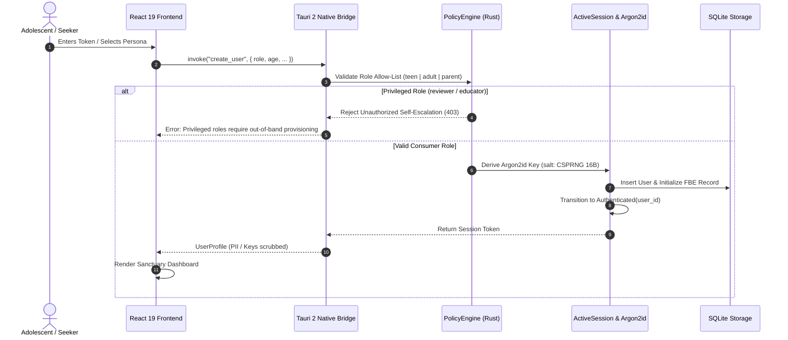
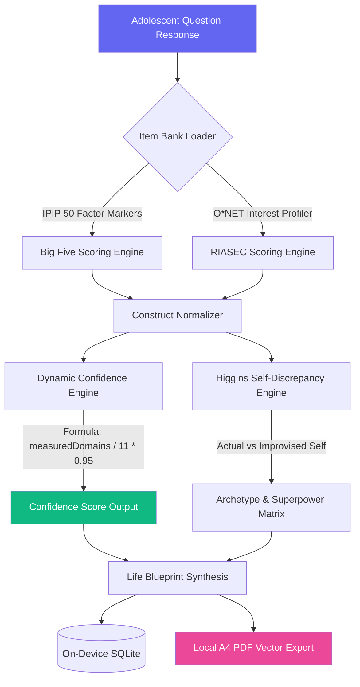
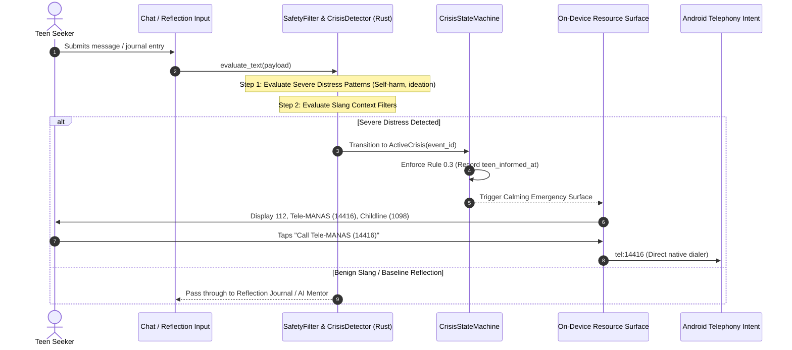
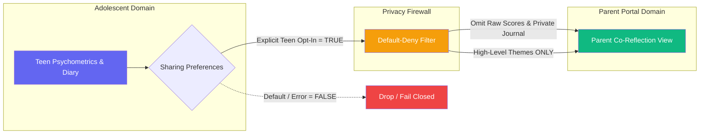
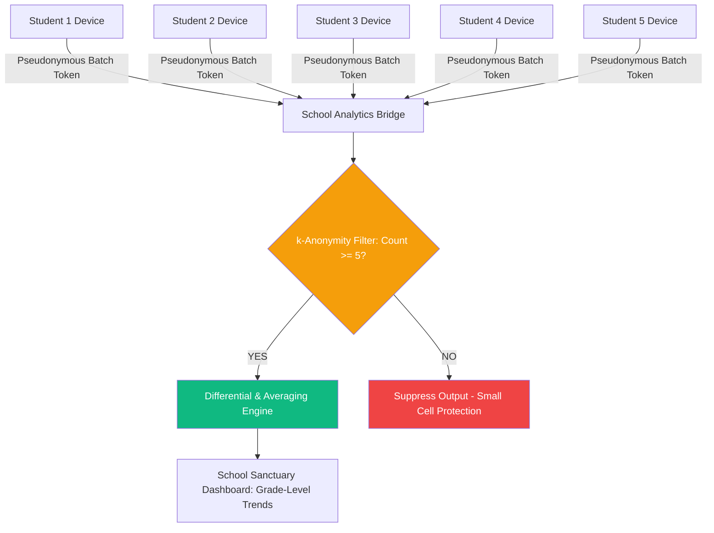

# PRERNA — Data Flow Architecture & Lifecycle Specification

**Version:** 1.2.3  
**Classification:** Enterprise Engineering Architecture Document  
**Target:** Local-First Android ARM64 & Cross-Platform Desktop  
**Compliance Standard:** DPDP Act 2023 §9, §11, §12 · Zero Cloud Psychometrics  

---

## 1. Overview & Data Flow Principles

PRERNA operates on a **Closed Local Data Loop**: data originates on the user's input surface, is processed in local memory, and is committed to encrypted on-device storage. At no point in the standard adolescent lifecycle does sensitive data traverse external cloud networks.

```
┌────────────────────────────────────────────────────────────────────────────────────────┐
│                              THE CLOSED LOCAL DATA LOOP                                │
├────────────────────────────────────────────────────────────────────────────────────────┤
│  User Interaction (Voice / Touch / Key)                                                │
│         │                                                                              │
│         ▼                                                                              │
│  Tauri 2 Typed IPC Protocol (JSON-RPC)                                                 │
│         │                                                                              │
│         ▼                                                                              │
│  Native Policy & Invariant Engine (Rust)                                               │
│         │                                                                              │
│         ▼                                                                              │
│  Local SQLite Engine (AES-256 / FBE Sandbox chmod 0600)                                │
│         │                                                                              │
│         ▼                                                                              │
│  On-Device Self-Discovery Synthesis (Instant Local-First Feedback)                     │
└────────────────────────────────────────────────────────────────────────────────────────┘
```

---

## 2. End-to-End Data Flow Diagrams

### 2.1 Ingestion, Authentication & Persona Activation



---

### 2.2 Psychometric Scoring & Synthesis Flow



---

### 2.3 Crisis Detection & Offline Safeguard Flow



---

### 2.4 Parent Co-Reflection & Firewall Boundary



---

### 2.5 Institutional School Analytics ($k \ge 5$)



---

## 3. Data Classification & Retention Table

| Data Category | Specific Fields | Storage Location | Encryption Standard | Retention Period | Purge Action |
|---|---|---|---|---|---|
| **Identity & Auth** | User ID, Username, Password Hash, PIN Salt | Native SQLite `users` table | Argon2id + AES-256 | Active account lifecycle | SQL DELETE + Zeroize memory |
| **Psychometrics** | Big Five traits, RIASEC vectors, confidence scores | Native SQLite `assessments` | AES-256-GCM authenticated | Lifetime of user account | Cascading SQL delete on erasure |
| **Wellbeing & Journal** | Somatic logs, strengths reflections, Maslow needs | Native SQLite `growth_journals` | AES-256-GCM / FBE sandbox | Until user edit/delete | Immediate overwrite + WAL truncate |
| **Crisis Records** | Event ID, classification, severity, escalation log | Native SQLite `crisis_events` | AES-256-GCM authenticated | Statutory audit requirements | Pseudonymized retention for compliance |
| **Parent Sharing** | Toggle flags (`wellbeingScore`, `themes`) | Native SQLite `sharing_preferences` | SQLite FBE | Active pairing session | Revoked instantly on teen toggle |
| **School Tokens** | Cryptographic batch identifiers (`SCH-BATCH-*`) | Ephemeral session state | In-memory only | Session duration | Purged on app exit |

---

## 4. Verification & Integrity Assertions

- **Zero-Network Invariant:** Network socket inspections confirm zero outbound requests during assessment completion, journal persistence, and crisis evaluation.
- **Erase-All Assertion:** Cold-start inspection after `delete_user_data` confirms zero database records and empty `localStorage`.
- **Identity Isolation Assertion:** Regression test `test_t15_7_cross_user_isolation` confirms that multiple user profiles on a shared device have zero cross-read capabilities.

