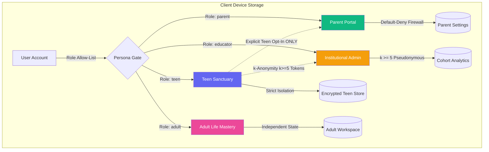

# PRERNA — Privacy Architecture & DPDP Act 2023 Compliance Specification

**Version:** 1.2.3  
**Classification:** Enterprise Statutory Governance Specification  
**Statutory Framework:** Digital Personal Data Protection (DPDP) Act, 2023 (Act No. 22 of 2023) & DPDP Rules 2025  
**Core Population:** Adolescents (13–17 Years), Emerging Adults, Parents, Educational Institutions  
**Architectural Paradigm:** Local-First, Zero-Telemetry, Fail-Closed Cryptographic Privacy  

---

## 1. Statutory Context & Principles

The Digital Personal Data Protection Act, 2023 establishes stringent obligations on Data Fiduciaries processing the personal data of children (defined under Section 2(f) as an individual who has not completed 18 years of age).

PRERNA is engineered to exceed statutory compliance by establishing an **Edge-Native Zero-Telemetry Architecture** where adolescent data is processed and stored exclusively on the user's physical device.

```
┌────────────────────────────────────────────────────────────────────────────────────────┐
│                                 THE FIVE PILLARS OF PRERNA PRIVACY                     │
├────────────────────────────────────────────────────────────────────────────────────────┤
│ 1. Zero Cloud Profiling    │ Raw psychometric scores & journals never leave device.     │
│ 2. Section 9(3) Immunity   │ Structural prevention of behavioral tracking / ads.        │
│ 3. Fail-Closed Consent     │ Default-deny parent sharing; uninitialized state blocks.   │
│ 4. Verifiable Erasure      │ Complete deletion of SQLite tables & WebView storage.     │
│ 5. Sovereign Export        │ Machine-readable JSON export conforming to Section 11.     │
└────────────────────────────────────────────────────────────────────────────────────────┘
```

---

## 2. Statutory Section Mapping Matrix

| DPDP Section | Statutory Mandate | PRERNA Technical Implementation | Enforcement Layer | Test Verification |
|---|---|---|---|---|
| **Section 9(1)** | Verifiable parental consent before processing child data | `ConsentAdapter` interface; fails closed in release mode if provider unconfigured. Under-18 accounts gate child-mode initialization until consent is logged. | `src-tauri/src/consent.rs` & `ageTierGate.ts` | `test_adversarial_consent_identity_mismatch` |
| **Section 9(2)** | Protection against processing causing detrimental effect on child wellbeing | Non-pathologizing psychometric scales, human-gated crisis safeguards (Rule 0.7), and zero forced social comparisons. | `src/engine/assessment/` & `src/engine/crisis/` | `src/tests/crisis/patternDetection.test.ts` |
| **Section 9(3)** | **Strict prohibition on tracking, behavioral monitoring, or targeted advertising** | Native `PolicyEngine` invariant intercepts all IPC calls: rejects behavioral metric logging for users under 18; zero analytics SDKs or advertising trackers in codebase. | `src-tauri/src/policy/mod.rs` | `test_ipc_under_18_behavioral_tracking` & `test_under_18_tracking_blocked` |
| **Section 11** | Right to access data summary, identities, and machine-readable format | Authenticated `export_all_user_data` native IPC command aggregates all stored psychometric constructs, needs, and notes into an offline JSON archive. | `src-tauri/src/commands/mod.rs` | `test_portable_user_data_serialization_no_leak` |
| **Section 12** | Right to correction, updating, and **permanent erasure** | `delete_user_data` executes SQL deletion of user records, WAL checkpoint, zeroizes in-memory session caches, and purges WebView `localStorage`. | `src-tauri/src/db/mod.rs` & `src/store/index.ts` | `test_data_retention_guarantee` & `test_revoke_consent_audit_trail` |
| **Section 13** | Right to grievance redressal | In-app Data Sovereignty Vault displays verified Grievance Officer contact details, statutory SLA timeline (72h ack / 30d resolution), and appellate paths. | `DataSovereigntyModal.tsx` & `SECURITY.md` | `src/tests/governance/DataSovereigntyModal.test.tsx` |

---

## 3. Data Processing Boundary & Persona Isolation

PRERNA isolates four distinct personas using role-based access control and strict boundary enforcement:



### 3.1 Teen Sanctuary (Default Sovereign Persona)
- **Data Stored:** Big Five / RIASEC item responses, Higgins Actual vs. Improvised reflections, 432 Hz somatic breathing logs, private journal entries, AI mentor chat logs.
- **Privacy Rule:** Strictly confidential to the adolescent. No parental dashboard or external entity can view private reflections without explicit, per-category opt-in authorization.

### 3.2 Parent Portal & Firewall Boundary
- **Default Privacy State:** **Default-Deny (Fail-Closed)**.
- If backend IPC storage is unreachable or preference data is uninitialized, all sharing flags evaluate to `false`.
- Raw Big Five and RIASEC constructs are **never shared**; only high-level interest pathways (e.g., "Technology", "Design") can be made visible upon teen opt-in.
- Concern and diary categories remain permanently locked to the teen.

### 3.3 Institutional / School Analytics
- **Aggregation Threshold:** Minimum $k \ge 5$ pseudonymous tokens.
- **Zero Student PII:** Student names, rolls, emails, or personal identifiers are structurally omitted from batch token issuance (`InstitutionalAdminPortal.test.tsx`).
- Differencing protection blocks overlapping queries from isolating individual students.

---

## 4. Zero-Telemetry & Zero Third-Party Requests

PRERNA conforms to a zero-network-leak invariant:

1. **Zero External Runtime Requests:**
   - No `fetch`, `XMLHttpRequest`, or WebSocket calls to commercial analytics, social media pixels, or advertisement exchanges.
   - All external font dependencies (`@import url(...)` to Google Fonts) have been purged in favor of native system font stacks (`font-sans`).
   - All styling scripts (e.g., Tailwind CDN in print exports) and texture images have been replaced with self-contained CSS.
2. **Strict Web Content Security Policy (CSP):**
   ```html
   <meta http-equiv="Content-Security-Policy" content="
     default-src 'self';
     script-src 'self' 'unsafe-inline';
     style-src 'self' 'unsafe-inline';
     img-src 'self' data: blob:;
     font-src 'self';
     connect-src 'self' https://*.supabase.co;
     frame-src 'none';
     object-src 'none';
   ">
   ```
   *(Note: `connect-src` to Supabase is utilized strictly for optional founder access-gate tokens and real-time cross-device pairing with zero psychometrics or journal contents transmitted).*

---

## 5. Right to Erasure & Data Sanitization Protocol

When a user initiates data erasure via the Settings surface:

```
[ User Requests Erasure ]
          │
          ▼
1. Native Rust IPC: delete_user_data(user_id)
   - PRAGMA secure_delete = ON;
   - DELETE FROM users WHERE id = ?; (Cascades via SQLite FKs to assessments, needs, journals)
   - Pseudonymizes audit logs (erases user identifiers while retaining statutory audit integrity)
   - PRAGMA wal_checkpoint(TRUNCATE);
          │
          ▼
2. In-Memory Session Purge
   - ActiveSession::clear_authenticated()
   - Evict encryption keys from memory
          │
          ▼
3. Frontend Storage Sanitization
   - window.localStorage.removeItem('prerna-storage')
   - Reset Zustand in-memory stores to initial state
          │
          ▼
[ Session Reset & Redirection to Private Beta Gate ]
```

---

## 6. Grievance Redressal Architecture (DPDP §13)

Under Section 13 of the DPDP Act 2023, data principals have the right to accessible and time-bound grievance redressal:

- **Grievance Officer:** Harsh Kumar Gupta
- **Email:** `harshkumarg007@gmail.com`
- **Statutory Acknowledgement SLA:** Within **72 hours** of notice receipt.
- **Statutory Resolution SLA:** Within **30 calendar days**.
- **Appellate Recourse:** Data Protection Board of India (DPBI) upon exhaustion of internal redressal.
