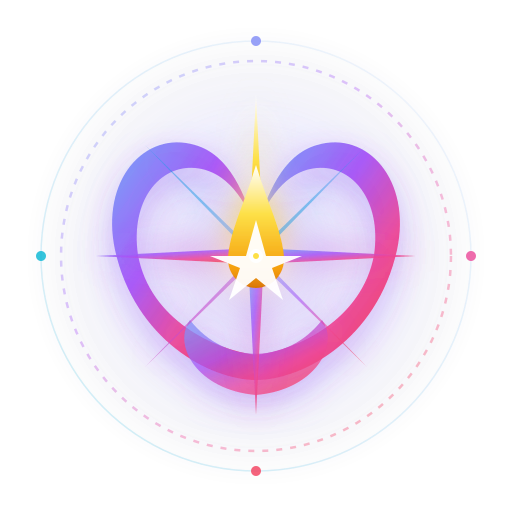

<div align="center">
  
  
  <p align="center">
    <strong>प्रेरणा • Inspiration Within</strong><br/>
    <em>A Local-First, Privacy-Preserving Adolescent Self-Discovery, Career Guidance & Wellbeing Sanctuary</em>
  </p>

  <p align="center">
    
    
    
    
    
  </p>
</div>

---

### Personalized Real-time Engagement & Neural Resource Assistant

**A local-first, privacy-preserving self-discovery, career exploration, and AI-assisted mentoring platform for adolescents (Desktop & Android).**

PRERNA combines empirical psychometric assessments (IPIP Big Five & O*NET RIASEC), localized career exploration (100+ pathways aligned with India's National Career Service & O*NET), wellbeing reflection, an offline AI mentor, human-gated crisis safeguards, and privacy-preserving parent/school interfaces.

The project is governed by a fundamental principle:

> **The person using PRERNA owns their data: they must always understand what the system collects, why it collects it, and who can access it. No profile data is collected before explicit, informed disclosure.**

PRERNA is built as a **local-first application**: core user data, psychometric scores, and conversation state remain encrypted on the user's device (via SQLCipher AES-256 on desktop and Android File-Based Encryption with application UID isolation on mobile).

> **Important:** PRERNA is an engineering implementation and is **not certified as a clinical, medical, legal, or production child-safety system**. Independent clinical review (H1–H3) and legal counsel sign-off (H4) remain mandatory gates prior to public deployment.

---

## 📌 Project Status

| Area | Status | Implementation Details |
| :--- | :--- | :--- |
| **Local-First Architecture** | ✅ Implemented | Core application state, chats, and psychometrics execute locally without telemetry |
| **Encrypted Local Database** | ✅ Implemented | Desktop: SQLCipher AES-256; Android: Bundled SQLite + Android File-Based Encryption (FBE) |
| **Android Mobile Support** | ✅ Built & Verified | Native `arm64-v8a` APK compiled via Tauri 2 + NDK 28 Clang cross-compilation pipeline |
| **Real Psychometric Item Banks** | ✅ Integrated | IPIP Big Five (Goldberg et al.) & O*NET RIASEC Interest Profiler instruments |
| **16 Personalities Typology** | ✅ Integrated | Big Five to 16-type Jungian mapping, cognitive functions, and interactive preference spectrums |
| **Career Pathways Database** | ✅ Integrated | 100+ vetted pathways with India NCS & O*NET alignment, education tracks & salary data |
| **Self-Evolution Sanctuary** | ✅ Implemented | The Mirror: Actual vs. Evolved Self, Higgins' Self-Discrepancy stepping stones, 3-phase growth roadmap |
| **Strengths & Growth Edges Journal**| ✅ Implemented | 100% on-device private journal, non-pathologizing reflections, DPDP Act 2023 S.9 compliant |
| **Personalized Self-Management** | ✅ Implemented | Dynamic matching engine across Big Five, learning style, and age tier; 10 micro-tools + custom creator |
| **Maslow Needs & Desires Compass** | ✅ Implemented | 5-tier adolescent pyramid, Wants vs. Needs classifier, distraction shield & hungry tier alert |
| **Verification & Test Coverage** | ✅ 119/119 Passing | 27 Vitest suites (119 tests passing), TypeScript `tsc --noEmit` 0 errors, production build verified |
| **AuthStatus Security Model** | ✅ Implemented | Backend state machine: `None → PendingMFA → Authenticated` with session eviction |
| **Renderer Identity Isolation** | ✅ Implemented | Backend resolves user identity via authenticated session; renderer cannot spoof `user_id` |
| **Role & Tenant Isolation** | ✅ Implemented | Strict backend authorization boundaries for Teen, Parent, Clinician, and Educator |
| **Local AI Mentor** | ✅ Engineered | RAG-hybrid domain retrieval + prompt safety filters; offline mock mode for mobile |
| **Human-Gated Crisis Protocol**| ✅ Implemented | Signal screening, slang suppression, clinician claim/resolution queue, Rule 0.3 gate |
| **DPDP Act 2023 Compliance** | 🚧 Architecture Mapped | Rule 0.1 (no behavioral tracking), Rule 0.3 (teen informed first), verified deletion |
| **Clinical Review (H1–H3)** | ⏳ Pending Review | Detection criteria and escalation matrices require licensed clinical psychologist sign-off |
| **Legal Review (H4)** | ⏳ Pending Review | DPDP mapping and parental consent architecture require certified legal counsel |
| **Production Beta** | ⏳ Blocked | Dependent on external clinical/legal sign-off tickets (Global Rule 0.7) |

---

## 🪷 The Soul of PRERNA: Atma-Jnana (Self-Realisation is God's Realisation)

> *"आत्मज्ञान बिना नर भटके, कोई मथुरा कोई काशी।  
> जैसे मृगा नाभि कस्तूरी, वन-वन फिरत उदासी।।  
> जल में मीन प्यासी, मोहे सुन-सुन आवत हाँसि।।"*  
> — **संत कबीर दास (Sant Kabir Das)**  
>  
> *"विधि हरि हर जाको ध्यान धरत हैं, मुनिजन सहज अठ्ठासी।  
> सोई हंस तेरे घट माहि, अलख पुरुष अविनाशी!"*  
> — **संत कबीर दास / संत वाणी परम्परा (Sant Kabir Das / Sant Vani Tradition)**

### The Genesis & Developer's Intent:
PRERNA (**प्रेरणा** — *Inspiration Within*) was brought into existence around a single, uncompromising foundational ideology:

> **"Self-Realisation is God's Realisation." (आत्म-साक्षात्कार ही ईश्वर-साक्षात्कार है)**

In an era where adolescents are pulled outward by endless algorithmic feeds, social comparison, and the anxious chase for external validation, they wander like the **Kasturi Mriga** (the musk deer) — despondently scouring dense forests for a divine fragrance that has always radiated from its own navel. 

Every capability in PRERNA is deliberately architected to turn the adolescent mirror inward:
- **16 Personalities & Big Five:** Not to categorize or label, but to understand the unique vessel (*घट*) of consciousness.
- **The Mirror (Actual vs. Evolved Self):** Higgins' Self-Discrepancy framework grounded in gentle self-compassion, awakening the indwelling Divine Swan (*सोई हंस*).
- **Strengths & Growth Edges Journal:** Mindful self-witnessing strictly on-device without cloud surveillance or judgment.
- **Personalized Behavioral Self-Management:** Calming the somatic nervous system so clarity and peace can be felt.
- **Maslow's Needs vs. Desires Compass:** Disentangling fleeting dopamine cravings from foundational physiological and emotional truth.
- **Local-First DPDP Sovereignty:** Because a seeker's inner sanctuary belongs to them alone, never to a corporate cloud.

---

## 🎨 Brand Identity & Design Philosophy

PRERNA (प्रेरणा — *Inspiration*) is built upon a distinct, copyright-free brand identity tailored specifically to adolescent psychology, emotional safety, and cultural resonance:

<div align="center">
  
</div>

- **The Inner Spark / Diya (प्रेरणा):** Positioned at the crest, symbolizing awakening, intrinsic motivation, and the flame of adolescent self-clarity.
- **The Guiding Star (Dhruva Tara / North Star):** Anchors personal trajectory, career exploration, and purposeful life direction.
- **The Lotus Guidance Wings (Padma):** Radiating outward, representing resilience, non-judgmental acceptance, and the blooming of adolescent potential in adversity.
- **The Sanctuary Orbit:** A soft, glowing circular perimeter reflecting DPDP Act 2023 Rule 0.1/0.3 cryptographic containment and local-first data privacy.
- **Chromatic Atmosphere:** Twilight celestial gradients (`#818CF8` Indigo, `#A855F7` Purple, `#EC4899` Rose, `#06B6D4` Cyan) paired with deep midnight (`#0B0F1E`) to create an inviting, soothing, and relaxing visual sanctuary.

---

## 📱 Cross-Platform Architecture (Desktop & Android)

PRERNA is designed as a unified codebase spanning Desktop (Windows, macOS, Linux) and Mobile (Android):

```text
┌────────────────────────────────────────────────────────────────────────┐
│                        REACT 19 + TYPESCRIPT UI                        │
│                   Vite + Tailwind CSS v4 + Zustand                     │
└───────────────────────────────────┬────────────────────────────────────┘
                                    │ Tauri 2 IPC
                                    ▼
┌────────────────────────────────────────────────────────────────────────┐
│                       RUST BACKEND CORE (Tauri 2)                      │
│            AuthStatus Session · Policy Gates · Crisis Detection        │
└───────────────────┬────────────────────────────────┬───────────────────┘
                    │                                │
         [Desktop: Windows/macOS/Linux]         [Mobile: Android]
                    │                                │
   ┌────────────────┴───────────────┐     ┌──────────┴────────────────┐
   │ SQLite / SQLCipher (AES-256)   │     │ SQLite (Amalgamation)     │
   │ OS Keyring Service             │     │ Android FBE Sandbox (0600)│
   │ Local GGUF LLM (RTX 4060)      │     │ Mobile RAG / Mock LLM     │
   └────────────────────────────────┘     └───────────────────────────┘
```

### Android Build Details
- **Architecture:** `aarch64-linux-android` (`arm64-v8a`)
- **API Target:** Minimum API 24 (Android 7.0 Nougat) — Target API 36 (Android 15)
- **Output Artifacts:**
  - **Signed Release APK (11.3 MB, Standalone Offline):** `src-tauri/gen/android/app/build/outputs/apk/arm64/release/app-arm64-release.apk`
  - **Debug APK (115 MB):** `src-tauri/gen/android/app/build/outputs/apk/arm64/debug/app-arm64-debug.apk`
- **Zero-Network Offline Protocol:** Uses Tauri 2 `custom-protocol` asset bundling to stream frontend assets directly from memory (`http://tauri.localhost/`), eliminating any runtime requirement for a local Vite dev server.
- **Security Isolation:** Enforces Android application UID isolation, sandboxed private directory storage (`/data/user/0/com.lenovo.prerna/databases`), and zero cleartext network traffic in production.

---

## 📊 Real-World Empirical Datasets

PRERNA replaces synthetic and mock assessment data with validated, empirical datasets:

### 1. Psychometric Instruments (`data/psychometrics/`)
- **Big Five Inventory (IPIP-NEO-120 Item Bank):** Validated item bank from Goldberg et al. / Open Source Psychometrics covering Openness, Conscientiousness, Extraversion, Agreeableness, and Neuroticism with reverse-scored calibration.
- **Holland Code RIASEC Assessment:** 60-item interest assessment based on the U.S. Department of Labor O*NET Interest Profiler covering Realistic, Investigative, Artistic, Social, Enterprising, and Conventional archetypes.
- **16 Personality Types & Cognitive Functions:** Empirical mapping of Big Five traits to 16 Jungian psychological types with four-letter spectrums (E/I, S/N, T/F, J/P), cognitive functions (Ni, Ne, Ti, Fi, etc.), study environment preferences, and friction triggers.

### 2. Career Pathways Database (`data/careers/`)
- **100+ Vetted Occupations:** Comprehensive pathways mapped to India’s **National Career Service (NCS)**, Ministry of Labour & Employment, and **O*NET 28.0**.
- **Localized Context:** Structured streams (Science/PCM/PCB, Commerce, Humanities, Vocational), entry degrees (B.Tech, MBBS, B.Des, ITI, CA, CLAT), average entry-to-mid career salary ranges in INR (LPA), and 5-year sector growth outlooks.

---

## ✨ Core Capabilities

### 🧬 16 Personality Types & Archetypal Spectrums
* Translates calibrated IPIP Big Five dimensions into the 16 Jungian psychological archetypes (e.g., INTJ Mastermind, ENFP Campaigner, ISTP Virtuoso, INFJ Advocate).
* Interactive preference spectrums (Introversion vs Extraversion, Intuition vs Sensing, Thinking vs Feeling, Judging vs Perceiving) displaying dynamic balance percentages.
* Cognitive function hierarchies, communication tendencies, optimal study environments, and friction triggers.

### 🪞 Self-Evolution Sanctuary (Actual vs. Evolved Potential)
* Grounded in Higgins' Self-Discrepancy Theory: compares the teen's "Actual Current Self" with their "Evolved Ideal Self" without guilt, pressure, or pathologization.
* Generates 3 sequential Stepping Stone growth phases (Awareness & Micro-habits → Active Reconditioning → Identity Integration).
* Side-by-side mirror cards celebrating inherent superpowers while identifying gentle growth edges.

### 📓 Strengths & Growth Edges Journal (DPDP Act Local-First)
* Non-pathologizing, mindful logging across 3 modalities: "Superpower Win 🌟", "Growth Edge / Friction ⚡", and "Free Reflection 💭".
* **100% On-Device Storage:** Entries are persisted strictly in `localStorage` — zero behavioral telemetry, zero cloud data transfer, complying strictly with DPDP Act 2023 Section 9.
* Tag filtering, energy resonance ratings (1–5), linked self-management tools, and chronological history log.

### ⚡ Personalized Behavioral Self-Management Engine
* **10 Evidence-Based Micro-Interventions:** CBT/ACT and somatic regulation tools including 5-Minute Micro-Start, 20/5 Dopamine Sprint, Single-Priority Funnel, Thought vs. Fact Detangler, 4-7-8 Somatic Vagal Reset, 3-Second Active Pause, Social Recharge Shield, Respectful Boundary Script, 70% Good-Enough Release, and Micro-Victory Evidence Jar.
* **Dynamic Multi-Dimensional Personalization:** Evaluates Big Five traits, 16-type archetype, sensory learning style (Visual, Auditory, Kinesthetic), and age tier (13–15, 16–17, 18+) to score tool relevance (0–99%).
* **Custom Tool Creator:** Empowers adolescents to author and save their own personalized coping and self-management strategies on-device.

### 🧭 Maslow's Needs & Desires Compass (Adolescent Distraction Shield)
* **Adolescent 5-Tier Pyramid:** Maps personal state across Level 1 (Physiological), Level 2 (Safety), Level 3 (Belonging), Level 4 (Esteem), and Level 5 (Self-Actualization).
* **Automated Wants vs. Needs Detangler (`discernWantVsNeed`):** Heuristic classifier that evaluates adolescent impulses and categorizes them into Dopamine Traps (scrolling, late-night junk food, avoidance, clout), Healthy Desires, or Core Foundational Needs with 10-minute nourishing alternatives.
* **Hungry Tier Alert & Foundation Health Index:** Detects when lower physiological or safety tiers are starved, preventing compulsive dopamine-seeking at the root.
* **Tracked Desires Audit Log:** One-click "Mark as Redirected ✨" action to reinforce healthy habit redirects.

### 🔐 Local-First Privacy & Data Sovereignty
* Sensitive user information is processed entirely on-device.
* Zero behavioral tracking for all under-18 accounts (**Global Rule 0.1**).
* Full data sovereignty: Teens and parents can export their complete profile (`export_all_user_data`) as verified JSON and invoke cryptographic erasure (`delete_user_data`).

### 🧠 Local AI Mentor & Hybrid RAG
* AI mentor runs without external cloud dependency.
* Retrieval-Augmented Generation (RAG) grounds guidance in verified career profiles, self-evolution goals, and coping strategies.
* Real-time safety filters catch crisis keywords and self-harm ideation, automatically suppressing conversational generation and presenting emergency helplines (Tele-MANAS, Vandrevala Foundation, Childline 1098).

### 🎮 Transparent Self-Discovery & Skill Arena
* Interactive games and activities (Spatial Puzzle, Reaction Test, Pattern Recognition, Life Quests, Mood Mirror).
* **Strict Disclosure Gating:** No profile telemetry is gathered prior to explicit user acknowledgement via `DisclosureGate`.

### 🚨 Human-Gated Crisis Escalation
* **Rule 0.3 Invariant:** Guardian notifications are strictly blocked until the teen is informed (`teen_informed_at != null`).
* **Rule 0.7 Invariant:** Automated systems never self-certify crisis resolution. All high-severity events require human clinician claim and resolution (`ReviewerClaim` → `Resolution`).
* Slang-aware NLP filter suppresses false positives on adolescent colloquialisms (e.g., "this test is killing me", "slayed that exam").

### 👨👩👧 Transparent Parent & School Interfaces
* Privacy-preserving shared dashboard: Parents see growth themes, activity consistency, and strengths without violating the teen's diary, mood journal, or private thoughts.
* School analytics enforce **`k ≥ 5` anonymization thresholds** to prevent individual profiling from aggregate reports.

---

## 🧰 Technology Stack

| Layer | Technology | Purpose |
| :--- | :--- | :--- |
| **Frontend Framework** | React 19 | Declarative UI for desktop and mobile webview |
| **Language** | TypeScript 5.8 | Type-safe application logic across all modules |
| **Build Tooling** | Vite 7.3 | High-performance bundling and asset optimization |
| **Styling** | Tailwind CSS v4 | Responsive layout, modern tokens, dark/light themes |
| **State Management** | Zustand | Local reactive state with storage persistence |
| **Application Runtime** | Tauri 2 | Secure native bridge connecting web UI to Rust core |
| **Backend Core** | Rust 2021 | Memory-safe, high-performance security policies |
| **Mobile Toolchain** | Android NDK 28, Gradle 8.14, Kotlin | Cross-compiling native Android shared libraries and APK |
| **Desktop Database** | SQLite + SQLCipher (`rusqlite`) | AES-256 encrypted local database storage |
| **Mobile Database** | SQLite Amalgamation (`rusqlite`) | Native storage protected by Android UID & FBE sandbox |
| **Local LLM Engine** | `llama-cpp-2` (Desktop) / Mobile RAG | Offline quantized GGUF inference and contextual retrieval |
| **Testing & Quality** | Vitest 4.1 | 27 test suites, 119/119 unit & integration tests passing |

---

## 📂 Repository Structure

```text
PRERNA/
│
├── .cargo/                         # Global Rust target linker configurations
├── data/
│   ├── careers/                    # Real NCS & O*NET career pathways database
│   └── psychometrics/              # Real IPIP Big Five & O*NET RIASEC item banks
│
├── docs/
│   ├── PRD.md                      # Product Requirements Document
│   ├── architecture.md             # System architecture & boundary specification
│   ├── dpdp-compliance-mapping.md  # India DPDP Act 2023 legal-technical alignment
│   ├── crisis-protocol.md          # Clinician escalation & emergency response protocol
│   ├── synthetic-crisis-drill.md   # Non-production crisis simulation runbook
│   └── review-briefs/              # Briefs for clinical (H1–H3) & legal (H4) reviewers
│
├── src/
│   ├── ai/                         # Career classification, RAG engine & LLM client
│   ├── assessment/                 # Assessment engine, scoring & fusion algorithms
│   ├── components/
│   │   ├── activities/             # Mood Mirror, Social Compass, Life Quests
│   │   ├── crisis/                 # ResourceSurface, TrustedAdultConnector, SafetyPlan
│   │   ├── dashboard/              # TeenProfileView, SharedDashboard, CareerWidgets
│   │   ├── growth/                 # SelfEvolutionSanctuary, MaslowNeedsCompass, StrategyCards
│   │   ├── mentor/                 # AiMentorChat (local LLM UI)
│   │   ├── settings/               # AuditTrailViewer, DataGovernance, ConsentRevocation
│   │   └── skills/                 # Skill Arena (Spatial Puzzle, Reaction Test)
│   ├── engine/                     # Big Five, RIASEC, Fusion, and Audit logging engines
│   │   └── growth/                 # Self-evolution, 16-types, and Maslow needs engines
│   ├── store/                      # Zustand state store with auth state machine & growth persistence
│   └── tests/                      # 27 Vitest test suites (119 tests passing)
│       ├── ai/                     # LLM client and AI mentor tests
│       ├── assessment/             # Scoring, fusion, and 16 personalities tests
│       ├── components/             # UI component tests
│       ├── crisis/                 # Pattern detection and escalation router tests
│       ├── growth/                 # Self-evolution and Maslow needs engine tests
│       └── integration/            # Lifecycle and consent flow tests
│
├── src-tauri/
│   ├── src/
│   │   ├── ai/                     # Local LLM backend & GGUF model loader
│   │   ├── commands/               # Tauri IPC commands (auth, DB, crisis, export)
│   │   ├── db/                     # SQLCipher / SQLite database abstraction layer
│   │   ├── lib.rs                  # Tauri mobile/desktop application entry point
│   │   └── main.rs                 # Native desktop executable entry point
│   ├── gen/android/                # Android Studio Gradle project & Kotlin plugins
│   ├── Cargo.toml                  # Rust dependencies & target-gated features
│   └── tauri.conf.json             # Tauri security CSP, bundle & window config
│
├── package.json
└── README.md
```

---

## 🚀 Getting Started

### Prerequisites

Ensure you have the following installed:
- **Node.js:** v20.x or v22.x LTS
- **Rust Toolchain:** `rustup default stable`
- **Android SDK & NDK (Optional for Android builds):** Android SDK API 34+, NDK 28.x, Java 21 JDK

### Installation

```bash
# Clone the repository
git clone https://github.com/HarshkumarG007/PRERNA.git
cd PRERNA

# Install frontend dependencies
npm install
```

### Running Desktop Development Mode

```bash
# Launch the desktop application (React UI + Rust Tauri Backend)
npm run tauri dev
```

### Running Unit & Integration Tests

```bash
# Execute the full Vitest suite (119 tests across 27 suites)
npm test -- --run

# Verify TypeScript compilation (0 errors)
npx tsc --noEmit
```

### Building the Android Version (ARM64 Release & Debug)

```powershell
# Set Android environment variables (Windows PowerShell example)
$env:ANDROID_HOME = "C:\Users\<user>\AppData\Local\Android\Sdk"
$env:NDK_HOME = "$env:ANDROID_HOME\ndk\28.2.13676358"
$env:JAVA_HOME = "C:\Program Files\Android\Android Studio\jbr"
$env:PATH = "$env:JAVA_HOME\bin;$env:ANDROID_HOME\platform-tools;$env:PATH"

# Build Frontend Production Assets first
npm run build

# Build Android Release APK (arm64-v8a, signed and optimized for physical devices)
cd src-tauri/gen/android
.\gradlew.bat assembleArm64Release

# Built Release APK is ready at:
# src-tauri/gen/android/app/build/outputs/apk/arm64/release/app-arm64-release.apk (11.3 MB)

# Install directly to your physical phone (e.g. Vivo X200T) via ADB:
adb install -r app/build/outputs/apk/arm64/release/app-arm64-release.apk
```

> [!TIP]
> **Installing on Physical Phones (e.g. Vivo X200T):** You can directly copy `app-arm64-release.apk` to your phone's Internal Storage or WhatsApp/Drive and tap to install. Because it is signed with a valid signature and embeds all assets offline via `custom-protocol`, it launches independently without any network connection or development PC.

---

## 🔒 Safety & Ethical Commitments

PRERNA strictly adheres to core safety and privacy invariants:

1. **Global Rule 0.1 (No Behavioral Tracking):** Under-18 accounts permanently have `behavioral_tracking = false`. No dark patterns, algorithmic feeds, engagement loops, or covert behavioral telemetry are ever collected or processed.
2. **Global Rule 0.3 (Teen Autonomy First):** In crisis situations, guardian notification is gated behind `teen_informed_at`. Teens are treated as subjects with rights, not passive objects of surveillance.
3. **Global Rule 0.7 (No AI Self-Certification):** An AI agent cannot self-certify clinical safety or legal validity. External review tickets H1–H4 remain blocked from automated closure.

---

## 📜 Safety Disclaimer

PRERNA is **not** a healthcare provider, clinical diagnostic instrument, or emergency dispatch service. Any insights, psychometric scores, or AI conversations generated by PRERNA are intended strictly for educational self-discovery and personal reflection. If you or someone you know is in distress, please connect directly with real-world professional emergency resources:

- **Tele-MANAS (India):** `14416` or `1800-891-4416` (24/7 Toll-Free Mental Health Helpline)
- **KIRAN Mental Health Helpline:** `1800-599-0019`
- **CHILDLINE (India):** `1098`
- **Emergency Services:** `112`

---

## 📄 License & Author

**Author & Creator:** Harshkumar G. (`@HarshkumarG007`)  
**Foundational Creed:** *"Self Realisation is God's Realisation"* (आत्म-साक्षात्कार ही ईश्वर-साक्षात्कार है)  
**Philosophical Roots:** Inspired by Sant Kabir Das & the timeless Indian Atma-Jnana tradition  
**Repository:** [https://github.com/HarshkumarG007/PRERNA](https://github.com/HarshkumarG007/PRERNA)  
**License:** Released under the [MIT License](LICENSE).
