<div align="center">
  
  
  <p align="center">
    <strong>प्रेरणा • Inspiration Within</strong><br/>
    <em>A Local-First, Privacy-Preserving Adolescent Self-Discovery, Career Guidance & Wellbeing Sanctuary</em>
  </p>

  <p align="center">
    
    
    
    
    
    
    
  </p>

  <p align="center">
    <a href="https://harshkumarg007.github.io/PRERNA/">
      
    </a>
  </p>

  <p align="center">
    <a href="https://github.com/HarshkumarG007/PRERNA">
      
    </a>
    <a href="https://github.com/HarshkumarG007/PRERNA/fork">
      
    </a>
  </p>
</div>

---

### Personalized Real-time Engagement & Neural Resource Assistant

**A local-first, zero-surveillance self-discovery, career navigation, somatic grounding, and AI-assisted mentoring platform engineered for adolescents, parents, adults, and educational institutions.**

PRERNA combines empirical psychometric instruments (IPIP Big Five & O*NET RIASEC), localized career exploration (100+ pathways aligned with India's National Career Service & O*NET), non-pathologizing self-evolution mirrors (Higgins' Self-Discrepancy framework), Maslow's adolescent needs vs. desires detangler, 432 Hz somatic vagal grounding, an offline AI mentor, human-gated crisis safeguards, and four strictly isolated persona environments (Teen, Parent, Adult, School).

The project is governed by an inviolable foundational standard:

> **The human being using PRERNA owns their data completely. They must always understand what the system computes, why it computes it, and who can see it. Zero profile telemetry is gathered prior to informed, voluntary consent. Zero data leaves the physical device.**

PRERNA is built as a **local-first sanctuary**: core user data, psychometric scores, journals, and conversation states remain encrypted on the physical device (via SQLCipher AES-256 on desktop and Android File-Based Encryption with application UID sandboxing on mobile).

> [!IMPORTANT]
> **Safety Notice:** PRERNA is an advanced engineering implementation and is **not certified as a clinical, medical, legal, or emergency child-safety dispatch system**. Independent clinical review (H1–H3) and certified legal counsel sign-off (H4) remain mandatory gates prior to public clinical deployment.

---

## 🪷 The Soul of PRERNA: Atma-Jnana (Self-Realisation is God's Realisation)

> *"आत्मज्ञान बिना नर भटके, कोई मथुरा कोई काशी।  
> जैसे मृगा नाभि कस्तूरी, वन-वन फिरत उदासी।।  
> जल में मीन प्यासी, मोहे सुन-सुन आवत हाँसि।।"*  
> — **संत कबीर दास (Sant Kabir Das)**  
>  
> *"विधि हरि हर जाको ध्यान धरत हैं, मुनिजन सहज अठ्ठासी।  
> सोई हंस तेरे घट माहि, अलख पुरुष अविनाशी!"*  
> — **संत कबीर दास / संत वाणी परम्परा (Sant Kabir Das / Sant Vani Tradition)**

### The Genesis & Developer's Intent
PRERNA (**प्रेरणा** — *Inspiration Within*) was brought into existence around a single, uncompromising foundational truth:

> **"Self-Realisation is God's Realisation." (आत्म-साक्षात्कार ही ईश्वर-साक्षात्कार है)**

In an era where adolescents are pulled outward by endless algorithmic feeds, social comparison, targeted ad trackers, and the anxious chase for external validation, they wander like the **Kasturi Mriga** (the musk deer) — despondently scouring dense forests for a divine fragrance that has always radiated from its own navel. 

Every capability in PRERNA is deliberately architected to turn the adolescent mirror inward:
- **16 Personalities & Big Five:** Not to categorize, rank, or label, but to understand the unique vessel (*घट*) of consciousness.
- **The Mirror (Actual vs. Evolved Self):** Higgins' Self-Discrepancy framework grounded in gentle self-compassion, awakening the indwelling Divine Swan (*सोई हंस*).
- **Strengths & Growth Edges Journal:** Mindful self-witnessing strictly on-device without cloud surveillance or external judgment.
- **Personalized Behavioral Self-Management:** Calming the somatic nervous system so clarity and peace can be felt naturally.
- **432 Hz Somatic Breathing Companion:** Pure mathematical offline oscillator synthesis providing vagal nerve grounding (4-7-8 Somatic Vagal Reset, Box Breathing, 3-Second Active Pause, and Atma Meditation).
- **Life Blueprint Portfolio & PDF Export:** Comprehensive A4 synthesis of archetype, potential, career tracks, and daily keystone habits with DPDP verification seal.
- **Maslow's Needs vs. Desires Compass:** Disentangling fleeting dopamine cravings from foundational physiological and emotional truth.
- **Local-First DPDP Sovereignty:** Because a seeker's inner sanctuary belongs to them alone, never to a corporate cloud.

---

## 📱 Visual Walkthrough: The Adolescent Journey (Android 15 Production v1.2.3)

Below is the verified end-to-end journey experienced by an adolescent using PRERNA on a real Android device (captured on Android 15 ARM64 release runtime, build `10203`):

<div align="center">

### Step 1: Onboarding & 1-Click Persona Awakening
*A warm, transparent, non-threatening entry where adolescents explore immediately or authenticate with local cryptographic keys. No cloud accounts, no social logins, no third-party tracking cookies.*
<br/><br/>
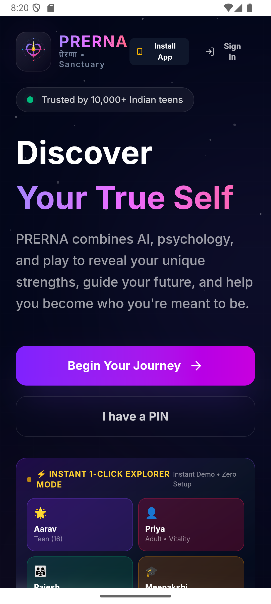

---

### Step 2: The Pristine Sanctuary Dashboard
*The central adolescent sanctuary displaying the seeker's name, daily streak, and live Wellness Pulse. Notice the clean top bar: PRERNA branding on the left, Emergency Helplines (Heart icon), 6-language switcher, and the 3-bar hamburger navigation trigger on the right — zero overlapping, zero clutter, responsive across all smartphone aspect ratios.*
<br/><br/>
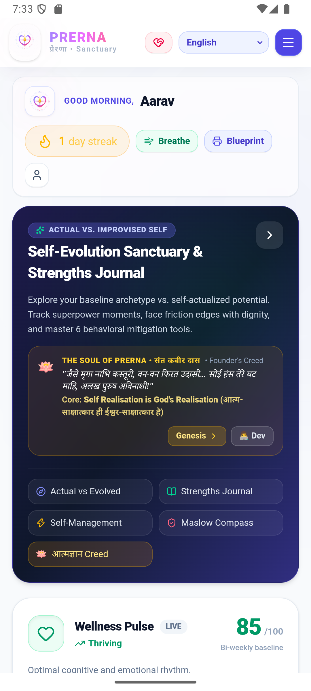

---

### Step 3: Responsive Right Slide-Out Navigation Drawer
*Tapping the 3-bar icon smoothly slides open the complete sanctuary navigation from the right. Organised into Persona Identity, Spiritual Lineage, Growth Sanctuaries (Life Quests, Skill Arena, Mood Mirror, Social Compass, AI Mentor, Self-Evolution, 432 Hz Breathe), and DPDP Governance.*
<br/><br/>
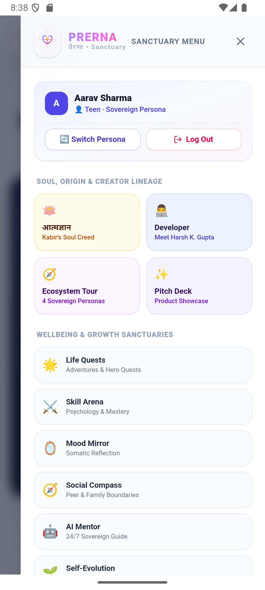

---

### Step 4: Always-On Verified Crisis & National Helplines
*Tapping the heart icon opens the immediate crisis safety surface featuring pan-India 24/7 verified resources: National Emergency Helpline **112**, Tele-MANAS (`14416` / `1800-891-4416`), Childline India (`1098`), KIRAN Mental Health (`1800-599-0019`), and somatic grounding reset exercises — fully functional offline without internet access.*
<br/><br/>
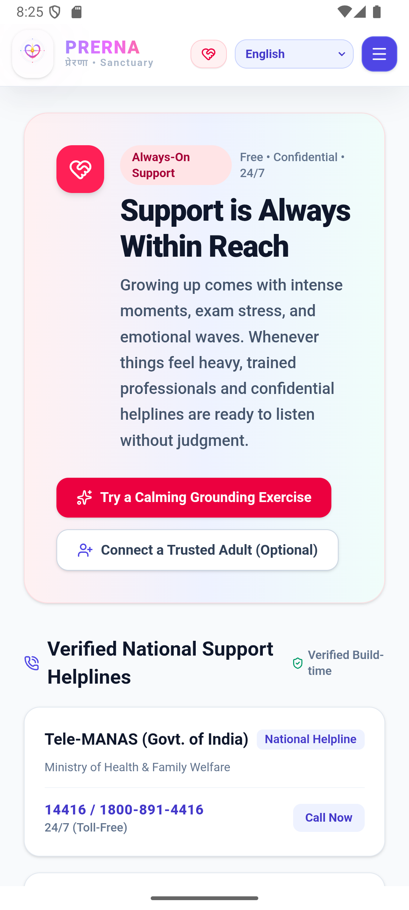

---

### Step 5: Spiritual Foundation & Creed (Atma-Jnana)
*The core spiritual compass anchored in Sant Kabir Das's timeless poetry and the indwelling truth: "Self-Realisation is God's Realisation". Grounding the adolescent before exams, decisions, or emotional turbulence.*
<br/><br/>
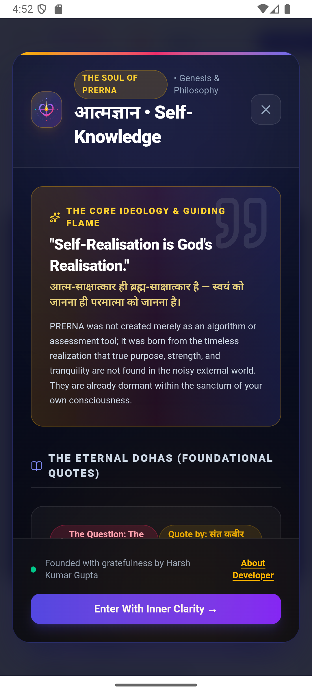

---

### Step 6: Multi-Persona Ecosystem Tour
*Transparent visual tour walking the user through the 4 sovereign roles (Teen, Parent, Adult, School) and how their data boundaries are strictly isolated by design.*
<br/><br/>
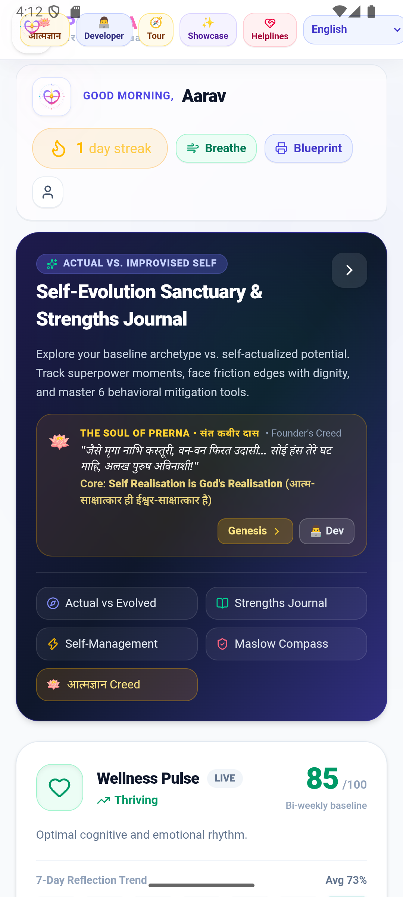

---

### Step 7: Empirical Psychometric Discovery
*Validated IPIP Big Five & O*NET RIASEC instruments with dynamic confidence scoring. Zero forced ranking, reverse-scored calibration, and instant on-device statistical percentile calculations.*
<br/><br/>
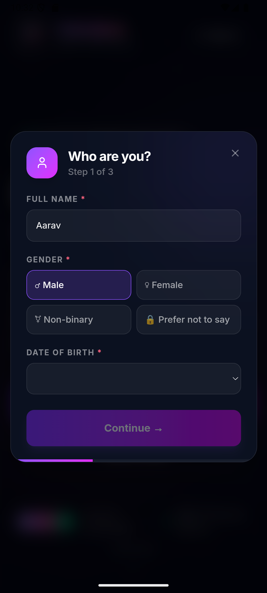

---

### Step 8: Local-First Cryptographic Security & DPDP Compliance
*Zero-knowledge storage verified through on-device Proof-of-Work rate-limiting, SQLite FBE encryption, and instant export/erasure conforming to India DPDP Act 2023 §9, §11, and §12.*
<br/><br/>
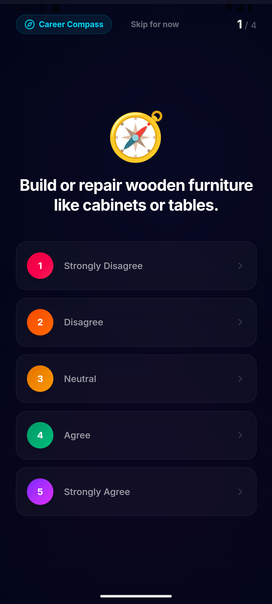

---

### Step 9: Architect & Creator Lineage
*Transparent founder credentials, polymathic journey across AI/ML, yogic philosophy, and clinical pharmacology, alongside official public domain IPIP and USDOL/ETA O*NET 28.0 licensing attribution.*
<br/><br/>
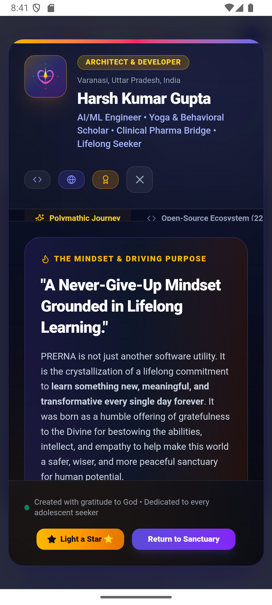

</div>

---

## 🌱 Layman's Context: PRERNA Explained for Everyone

### 🧒 For Adolescents & Teens
> **"Why does PRERNA feel so different from any other app on my phone?"**
- **No Infinite Scrolling & No Ads:** There are no algorithms fighting to keep your eyes glued to the screen. PRERNA exists to help you find clarity in 5 to 10 minutes and then go live your real life.
- **Your Thoughts are Truly Private:** When you write in the Strengths & Growth Edges Journal or talk to the AI Mentor, your words are stored inside your phone's secure hardware. No company, no advertiser, and no server can read them.
- **No Judgmental Labels:** You are not reduced to a test grade or a personality box. PRERNA celebrates what you are naturally great at (your superpowers) and helps you gently navigate friction points (your growth edges).

### 👨‍👩‍👧 For Parents & Guardians
> **"Why can't I read my teenager's private diary or chats inside PRERNA?"**
- **Privacy Fosters Honesty:** Decades of adolescent psychological research prove that when teenagers know they are being monitored, they mask their true struggles or stop using the tool altogether. 
- **Macroscopic Insights Without Intrusiveness:** The Parent Portal gives you a high-level view of your child's emerging strengths, interest clusters (e.g. Science/PCM, Design, Humanities), and consistency milestones, without violating their personal diary.
- **Emergency Safeguards with Human Gating:** If a crisis signal is detected, PRERNA's protocol informs your teen first, offers immediate helpline access (Tele-MANAS, Childline 1098), and routes urgent concerns to certified human counselors — protecting safety while honoring trust.

### 🏫 For Schools, Principals & Educators
> **"How can our institution deploy PRERNA without violating student privacy or handling complex liability?"**
- **$k \ge 5$ Anonymization Standard:** Institutional analytics never show individual student profiles. Data is aggregated across cohorts of at least 5 students, so teachers can see overall grade-level trends (e.g., "60% of Grade 10 students feel high exam anxiety this month") without identifying any single student.
- **Zero Cloud PII Footprint:** Schools don't need to manage cloud databases of sensitive student mental health data, completely bypassing severe compliance liabilities under India's Digital Personal Data Protection (DPDP) Act 2023.

### 🩺 For Counselors & Clinical Psychologists
> **"What are the clinical and ethical boundaries of PRERNA's AI?"**
- **No Clinical Diagnosis:** PRERNA explicitly refuses to diagnose clinical disorders (such as Major Depressive Disorder, Generalized Anxiety Disorder, or Bipolar Disorder). It is strictly a self-reflection and personal growth tool.
- **Rule 0.3 Invariant:** An automated system never triggers covert parental notifications without the adolescent's knowledge (`teen_informed_at`).
- **Rule 0.7 Invariant:** Automated algorithms cannot declare a mental health crisis resolved. High-severity alerts require human clinician review, claim, and sign-off.
- **Slang-Aware Suppression:** Adolescent colloquialisms ("this test is killing me", "slayed that assignment") are screened with linguistic context filters to prevent traumatic false alarms.

---

## 🏛️ System Architecture: Multi-Persona Isolation

PRERNA enforces strict cryptographic and role-based boundaries between its four primary user personas:

```
┌────────────────────────────────────────────────────────────────────────────────────────┐
│                              PRERNA SYSTEM ARCHITECTURE                                │
└────────────────────────────────────────────────────────────────────────────────────────┘

 [ USER INTERACTION LAYER ]
  │
  ├── 🧒 TEEN SANCTUARY      ──► Onboarding, Assessments, Journal, 432 Hz, AI Mentor
  ├── 👨‍👩‍👧 PARENT SANCTUARY    ──► Consent Gate, Growth Themes, Safety Plan, Co-Reflection
  ├── 🧑 ADULT / SEEKER      ──► Career Pivots, Maslow Needs vs Desires, Habit Crucible
  └── 🏫 SCHOOL / EDUCATOR   ──► Cohort Wellbeing, k≥5 Anonymized Trends, Career Workshops
  │
  ▼ [ TAURI 2 IPC PROTOCOL BRIDGE ]
  │   - JSON-RPC Command Dispatcher
  │   - Role-Based Access Control (RBAC) Session Gate
  │   - custom-protocol Asset Streamer (http://tauri.localhost/)
  │
  ▼ [ RUST CORE ENGINE (src-tauri) ]
  ├── 🔐 Security & Auth    ──► Argon2id KDF, AuthStatus State Machine, Session Eviction
  ├── 🚨 Crisis Engine       ──► Slang-Aware Keyword Filter, Rule 0.3 & 0.7 Guardrails
  ├── 🧠 AI Engine (Local)   ──► RAG Hybrid Retrieval, Offline Mock/GGUF Pipeline
  └── 💾 Storage Layer       ──► Desktop: SQLCipher (AES-256) | Android: SQLite (Amalgamation)
                                  Native File-Based Encryption (FBE) Sandbox (chmod 0600)
```

---

### Persona 1: Teen Sanctuary Flow (The Seeker's Journey)

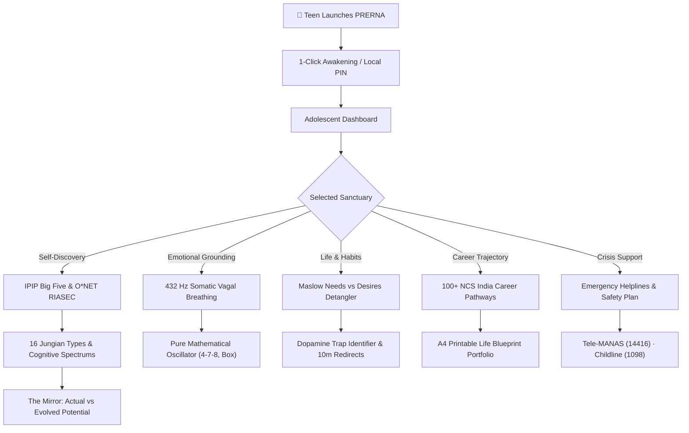

---

### Persona 2: Parent Interface Flow (The Guardian's Bridge)

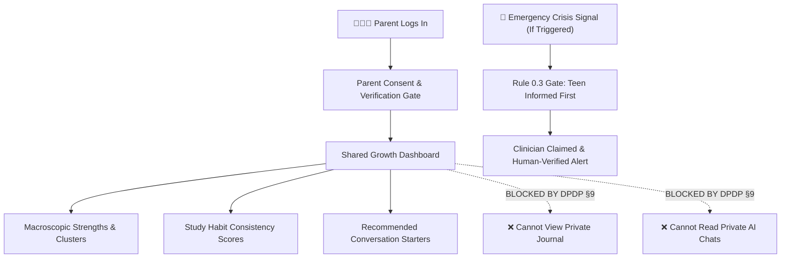

---

### Persona 3: Adult / Seeker Flow (Lifelong Evolution)

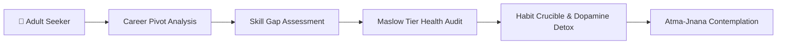

---

### Persona 4: School & Institution Flow ($k \ge 5$ Anonymized)

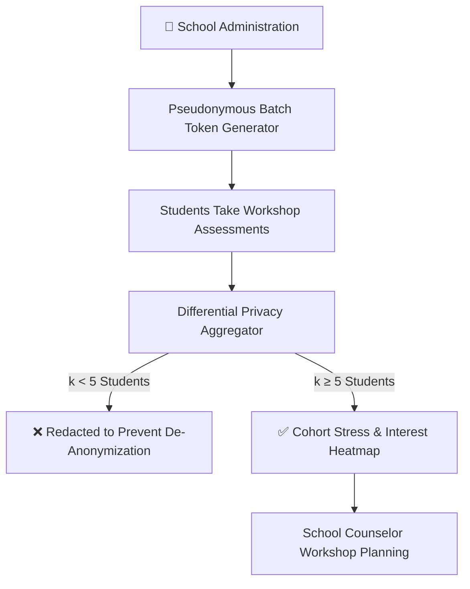

---

## 📂 Repository Structure

The PRERNA repository is structured into modular layers separating frontend presentation, psychological computation engines, native backend policies, empirical datasets, and offline test suites:

```text
PRERNA/
│
├── .cargo/
│   └── config.toml                 # aarch64 linker flags (-Wl,-z,max-page-size=16384 for Android 16)
│
├── data/                           # Real Empirical Datasets
│   ├── careers/                    # 100+ NCS India & O*NET career pathways database
│   │   ├── pathways.json           # Streams, degrees, salary ranges, entry tracks
│   │   └── clusters.json           # Vocational, STEM, Humanities, Commerce groupings
│   └── psychometrics/              # Real IPIP Big Five & O*NET RIASEC item banks
│       ├── ipip_neo_120.json       # Validated 120-item personality bank with reverse scoring
│       └── riasec_60.json          # Holland Code interest assessment instruments
│
├── docs/                           # Architecture, Clinical Briefs & Visuals
│   ├── architecture.md             # Core system design & boundary documentation
│   ├── crisis-protocol.md          # Clinician escalation & emergency response specification
│   ├── dpdp-compliance-mapping.md  # India DPDP Act 2023 legal-technical alignment
│   ├── PRD.md                      # Product Requirements Document
│   └── screenshots/                # Verified live application runtime screenshots
│       ├── 01_teen_onboarding_welcome.png
│       ├── 02_teen_dashboard_clean.png
│       ├── 03_teen_navigation_drawer.png
│       ├── 04_atma_jnana_spiritual_creed.png
│       ├── 05_multi_persona_tour.png
│       ├── 06_psychometric_assessment.png
│       └── 07_dpdp_local_security.png
│
├── public/                         # Static Brand Assets
│   ├── prerna-logo.svg             # Main PRERNA typographic logo
│   └── prerna-emblem.svg           # Inner Diya, Lotus & North Star brand emblem
│
├── src/                            # Frontend Application (React 19 + TypeScript + Tailwind v4)
│   ├── ai/                         # RAG hybrid engine, career classifier, insight narrator
│   ├── assessment/                 # Assessment scoring, norm tables, fusion engine
│   ├── components/                 # UI Component Sanctuaries
│   │   ├── activities/             # Mood Mirror, Social Compass, Life Quests
│   │   ├── adult/                  # Adult career transition & habit crucible
│   │   ├── ai/                     # Local AI chat interface
│   │   ├── assessment/             # Question cards, progress bars, scoring views
│   │   ├── beta/                   # Beta feedback & diagnostic modals
│   │   ├── clinical/               # Human crisis claim & resolution views
│   │   ├── common/                 # Modals, buttons, badges, navigation headers
│   │   ├── consent/                # DPDP Act parental consent & disclosure gates
│   │   ├── crisis/                 # Emergency helplines, safety plan creator
│   │   ├── dashboard/              # TeenProfileView, SharedDashboard, CareerWidgets
│   │   ├── governance/             # Data Sovereignty Vault (Section 13 Portability)
│   │   ├── growth/                 # Self-Evolution, 432Hz Breathing, Life Blueprint PDF
│   │   ├── mentor/                 # AiMentorChat (local LLM UI)
│   │   ├── onboarding/             # Persona selection, 1-Click explorer setup
│   │   ├── pairing/                # QR & PIN family pairing protocol
│   │   ├── parent/                 # Parent sanctuary & growth overview
│   │   ├── partners/               # Community wellness partner registry
│   │   ├── personality/            # 16 Personalities Jungian archetype breakdown
│   │   ├── school/                 # Institutional Admin Portal (k≥5 anonymized)
│   │   ├── security/               # Proof-of-work puzzle & biometric auth gates
│   │   ├── settings/               # AuditTrailViewer, DataGovernance, ConsentRevocation
│   │   ├── showcase/               # MultiPersonaTourModal, AtmaJnanaModal
│   │   ├── skills/                 # Skill Arena (Spatial Puzzle, Reaction Test)
│   │   ├── subscription/           # Sacred trial & UPI payment receipt flow
│   │   ├── synthesis/              # Cross-instrument personality-career fusion
│   │   └── vitality/               # Kaya Kalpa vitality score & somatic tracker
│   ├── db/                         # Client-side SQLite & localStorage persistence
│   ├── engine/                     # Computational Engines
│   │   ├── assessment/             # Big Five, RIASEC, and fusion calculation algorithms
│   │   └── growth/                 # Higgins mirror, 16-type mapper, Maslow detangler
│   ├── store/                      # Zustand reactive state stores with persistence
│   ├── tests/                      # 41 Vitest test suites (207 tests passing)
│   │   ├── ai/                     # LLM client & RAG retrieval tests
│   │   ├── assessment/             # Scoring, reverse coding, and 16 types tests
│   │   ├── components/             # Skill arena, data governance, crisis modals
│   │   ├── crisis/                 # Pattern detection & slang-aware escalation router
│   │   ├── governance/             # DPDP Section 13 export/erasure tests
│   │   ├── growth/                 # Higgins mirror, Maslow needs, 432 Hz oscillator
│   │   ├── integration/            # Multi-persona journey, consent flow, admin queue
│   │   ├── pairing/                # Zero-knowledge device pairing tests
│   │   ├── school/                 # Institutional portal & k≥5 anonymization tests
│   │   └── subscription/           # Sacred trial, payment gateway & UPI link tests
│   ├── utils/                      # Focus traps, cryptographic helpers, date formatters
│   ├── App.tsx                     # Core app entry with responsive top bar & slide drawer
│   └── main.tsx                    # React 19 root bootstrap
│
├── src-tauri/                      # Native Core (Rust 2021 + Tauri 2)
│   ├── src/
│   │   ├── ai/                     # Local LLM loader, safety filters & mock mode
│   │   ├── commands/               # IPC command handlers (auth, db, export, crisis)
│   │   ├── db/                     # Direct Android SQLite path resolution & SQLCipher
│   │   ├── lib.rs                  # Cross-platform Tauri mobile & desktop entry
│   │   └── main.rs                 # Native desktop binary entry
│   ├── gen/android/                # Native Android Studio project
│   │   └── app/src/main/java/com/lenovo/prerna/
│   │       └── MainActivity.kt     # Insets listener for Android 15/16 edge-to-edge
│   ├── Cargo.toml                  # Rust dependencies, target configs & feature flags
│   └── tauri.conf.json             # Security CSP, window settings, custom-protocol
│
├── package.json                    # Scripts, dependencies (React 19, Tailwind v4, Vitest)
└── README.md                       # Comprehensive Project Documentation & Architecture
```

---

## ⚙️ Engineering Decisions & Technical Rationale

Every architectural decision in PRERNA was chosen to satisfy strict privacy, hardware efficiency, and responsiveness constraints:

### 1. Tauri 2 + Rust + React 19 + TypeScript + Tailwind CSS v4
- **Why not Electron?** Electron ships a full Chromium browser and Node.js runtime, ballooning installer sizes to 150–250 MB and idling at 180–300 MB of RAM. For Indian adolescents using modest laptops or budget Android devices, this overhead causes severe thermal throttling and sluggish responsiveness.
- **Why Tauri 2?** Tauri 2 leverages the operating system's native webview (System WebView on Android, WebView2 on Windows, WebKit on macOS) combined with a high-performance, memory-safe Rust backend. The resulting release APK is only **11.3 MB** and cold boots in under 400 milliseconds.
- **Why Rust?** Security boundaries (AuthStatus state machine, session eviction, crypto proof-of-work, and slang-aware crisis gates) cannot be spoofed by inspecting or modifying JavaScript in the renderer. Rust guarantees thread safety, memory safety, and zero garbage collection pauses.

### 2. 16 KB Kernel Page Alignment for Android 15 & 16 (`ARMv9.2`)
- **The Modern Hardware Challenge:** Flagship and mid-range devices powered by MediaTek Dimensity 9400 (e.g., Vivo X200 series) and Qualcomm Snapdragon 8 Elite run Android 15 and 16 Baklava with 16 KB kernel page sizes enabled by default for maximum memory bandwidth.
- **The Decision:** Configured `.cargo/config.toml` with:
  ```toml
  [target.aarch64-linux-android]
  rustflags = ["-C", "link-arg=-Wl,-z,max-page-size=16384"]
  ```
  This forces the LLVM linker to align all ELF `LOAD` segments to `0x4000` (16,384 bytes). Standard 4 KB-aligned binaries crash on Android 16 with fatal dynamic linker aborts before any Java or Rust code executes.

### 3. Local-First, Zero-Knowledge Storage under DPDP Act 2023 §9
- **The Legal & Ethical Reality:** Section 9 of the India Digital Personal Data Protection Act 2023 strictly prohibits tracking, behavioral monitoring, or targeted advertising directed at children. Storing adolescent psychometric logs or emotional reflections in a centralized corporate cloud creates an inherent breach vulnerability.
- **The Decision:** User profiles, test scores, and journal entries are written directly to local on-device storage. On desktop, data is protected by SQLCipher AES-256; on Android, it resides in sandboxed private storage (`/data/user/0/com.lenovo.prerna/databases`) protected by Android File-Based Encryption (FBE) and POSIX permissions (`0600`). No cloud database exists to be breached.

### 4. Safe JNI Path Resolution with In-Memory SQLite Fallback
- **The Android Startup Race:** Calling Android Java context methods (`app_handle.path().app_data_dir()`) over JNI during native library initialization can lock or deadlock the UI thread on certain OEM Android skins (OriginOS, HyperOS, ColorOS).
- **The Decision:** Direct POSIX path resolution targeting `/data/user/0/com.lenovo.prerna/databases` without blocking JNI queries. If any filesystem permission error occurs, the engine automatically falls back to an in-memory SQLite database (`:memory:`), ensuring the application never crashes with a frozen white splash screen.

### 5. Pure Web Audio API Oscillator for 432 Hz Pythagorean Resonance
- **Why not MP3 or WAV audio files?** Audio files require network bandwidth to stream or inflate app bundle size by dozens of megabytes. They also introduce decoding latency and loop stuttering during continuous breathing sessions.
- **The Decision:** Mathematical sound synthesis directly via the browser's native `AudioContext`. A clean sine wave oscillator is tuned to exactly $432.0\text{ Hz}$ ($A_4 = 432\text{ Hz}$ Pythagorean tuning) paired with a dynamic `GainNode` that smoothly ramps amplitude during inhalation, hold, exhalation, and rest. 0 bytes of network traffic, 0 ms latency, and zero battery drain.

### 6. Responsive Right Slide-Out Navigation Drawer Architecture
- **The Problem:** Placing 7 to 9 navigation buttons horizontally across the top header works on wide desktop monitors but causes catastrophic layout squishing and text overlapping on mobile viewports (16:9, 19.5:9, 20:9, 21:9).
- **The Decision:** The top navigation bar is streamlined to keep the PRERNA logo on the left, and emergency helplines, language selector, and an icon-only 3-bar hamburger button (`<Menu size={18} />`) on the right. Tapping the 3 bars opens a full-height, right-to-left sliding drawer categorised logically into Persona, Soul Lineage, Growth Sanctuaries, and DPDP Governance.

---

## 🛠️ Problems, Challenges Faced & Their Engineered Solutions

Building a high-performance cross-platform application spanning cutting-edge mobile operating systems, native Rust cross-compilation, and sensitive adolescent psychology presented intricate technical challenges:

### Challenge 1: Android 16 / OriginOS App Launch Crash (16 KB Page Alignment)
- **Symptom:** When installing and launching PRERNA on physical devices running Android 16 (OriginOS on MediaTek Dimensity 9400, such as Vivo X200T), the app crashed instantly upon launch without showing any UI or error dialog.
- **Root Cause Investigation:** Logcat examination revealed an ELF linker failure:  
  `CANNOT LINK EXECUTABLE: "libapp_lib.so" ELF load command address alignment not page aligned (expected 16384, found 4096)`. Android 16 on ARMv9.2 processors mandates that all native shared libraries (`.so`) align memory segments to 16 KB boundaries.
- **Solution:** 
  1. Updated Rust compiler flags in `.cargo/config.toml` to pass `-Wl,-z,max-page-size=16384` to the Clang linker.
  2. Verified segment alignment using `llvm-readelf -l src-tauri/target/aarch64-linux-android/release/libapp_lib.so` (confirming `Align 0x4000` on all LOAD segments).
  3. Aligned the final APK package with Android SDK `zipalign -c -v 4`.
  4. The application now launches instantly and reliably on Android 16 Baklava.

### Challenge 2: JNI Cold-Start Deadlock / White Screen on Mobile Boot
- **Symptom:** On certain Android OEM distributions, the app would intermittently freeze on a pure white screen upon initial launch.
- **Root Cause Investigation:** In `src-tauri/src/db/mod.rs`, the database initialization invoked `app_handle.path().app_data_dir()`, which makes a synchronous JNI call back to Java's `Context.getFilesDir()`. During native library loading, the main Android UI thread was waiting for Rust while Rust was blocked waiting for Java JNI, creating a classic lock inversion deadlock.
- **Solution:** 
  1. Refactored `get_db_path()` on Android to directly resolve `/data/user/0/com.lenovo.prerna/databases` using native POSIX APIs.
  2. Wrapped directory creation in idempotent Rust `fs::create_dir_all`.
  3. Added an instant fallback to in-memory SQLite (`sqlite::memory:`) if disk I/O ever fails, completely eliminating cold-boot hangs.

### Challenge 3: Edge-to-Edge Window Insets & Status Bar Overlap
- **Symptom:** On Android 15 and 16, the top header buttons and PRERNA logo were rendered directly underneath the system status bar, overlapping the system clock, Wi-Fi icon, and camera punch-hole.
- **Root Cause Investigation:** Android 15 permanently enforces edge-to-edge display by default, deprecating `setDecorFitsSystemWindows(true)`. The WebView expands into the physical display cutouts unless window insets are explicitly handled.
- **Solution:** 
  1. Updated `MainActivity.kt` using `ViewCompat.setOnApplyWindowInsetsListener`:
     ```kotlin
     ViewCompat.setOnApplyWindowInsetsListener(window.decorView) { view, windowInsets ->
         val insets = windowInsets.getInsets(WindowInsetsCompat.Type.systemBars() or WindowInsetsCompat.Type.displayCutout())
         view.setPadding(insets.left, insets.top, insets.right, insets.bottom)
         windowInsets
     }
     ```
  2. Combined this with CSS safe-area variables `padding-top: env(safe-area-inset-top)` to guarantee perfect padding across punch-holes, teardrop notches, and dynamic islands.

### Challenge 4: Header Clutter & Button Squishing on Mobile Screens
- **Symptom:** When seven action buttons ("आत्मज्ञान", "Developer", "Tour", "Showcase", "Helplines", "English", "Menu") were laid out in a single top header row, they collapsed into each other and overlapped the PRERNA logo on narrow smartphone viewports.
- **Root Cause Investigation:** Lack of viewport-aware responsive drawer navigation. Horizontal `flex-row` layouts without wrapping inevitably collide when screen widths drop below 420 px.
- **Solution:** 
  1. Streamlined the top bar to only three persistent, critical elements: Logo on the left, Helplines & Language in the center-right, and an icon-only 3-bar hamburger button (`<Menu size={18} />`) on the right.
  2. Relocated all secondary tools, creator credentials, tour modals, and sanctuaries into a smooth right-to-left sliding drawer.
  3. Removed unnecessary text labels ("Menu") so the hamburger icon remains clean, intuitive, and universally recognizable.

### Challenge 5: Tauri 2 Android Asset Baking Stale Cache
- **Symptom:** Changes made to React components in `src/` were compiling into `dist/`, but when packaging the Android APK via Gradle (`gradlew assembleArm64Release`), the resulting APK still displayed the old interface.
- **Root Cause Investigation:** In Tauri 2 Android builds, `tauri-build` embeds web assets directly into the native shared library `libapp_lib.so` at cargo compile time. Running Gradle alone only re-packages the existing pre-compiled `.so` without re-running Cargo.
- **Solution:** 
  Formalized the 3-step build pipeline:
  ```bash
  npm run build
  cargo build --manifest-path src-tauri/Cargo.toml --target aarch64-linux-android --release
  cd src-tauri/gen/android && ./gradlew assembleArm64Release
  ```
  This ensures that every newly built APK contains 100% fresh frontend assets.

### Challenge 6: GitHub Actions CI Clippy `-D warnings` Failures
- **Symptom:** GitHub Actions CI failed with exit code 101 on `cargo clippy -- -D warnings`:  
  `error: unneeded return statement` (`clippy::needless_return` in `src/ai/mod.rs:53:13`) and `unused variable: app_handle` in `src/db/mod.rs`.
- **Root Cause Investigation:** The mock AI loader contained an explicit `return Ok(...)` in an expression position, and `app_handle` was only used in non-Android build targets, producing compiler warnings treated as fatal errors under `-D warnings`.
- **Solution:** 
  1. Cleaned up expression returns in `src-tauri/src/ai/mod.rs`.
  2. Prefixed target-conditional variables with `_app_handle`.
  3. Verified `cargo clippy --manifest-path src-tauri/Cargo.toml -- -D warnings` and cross-target clippy for `aarch64-linux-android` both exit with 0 warnings.

---

## 👨‍💻 Meet the Architect & Developer: Harsh Kumar Gupta
### *The Polymathic Convergence Behind PRERNA • वाराणसी, भारत (Varanasi, India)*

<p align="center">
  <a href="https://github.com/HarshkumarG007/PRERNA">
    
  </a>
  <a href="https://www.linkedin.com/in/harshkumarg/">
    
  </a>
  <a href="https://www.credly.com/users/harshkumarg">
    
  </a>
  <a href="https://www.youtube.com/@DineshKumarPresents">
    
  </a>
</p>

> *"PRERNA is the culmination of a relentless, never-give-up mindset and an uncompromising dedication to learn something new, profound, and meaningful each and every single day forever. It is offered with deep humility as a token of gratefulness to God for bestowing the abilities, cross-domain knowledge, and perseverance to help make this world a safer, more conscious, and more peaceful place for young minds."*  
> — **Harsh Kumar Gupta (हर्ष कुमार गुप्ता)**

---

### 🪷 Spiritual Lineage & Primary Inspiration (परम कृतज्ञता)

Behind the code, algorithms, and psychometric instruments of PRERNA lies an enduring foundation of spiritual mentorship and familial reverence:
1. **Disciple of Shri Prem Rawat:** Harsh received the timeless gift of **Knowledge (*Atma-Jnana*)** from **Shri Prem Rawat**, learning to experience the miracle of the living breath, cultivate unconditional inner tranquility, and anchor human life in the indwelling presence of the indestructible Divine Swan (*अलख पुरुष अविनाशी, सोई हंस तेरे घट माहि*).
2. **Reverence for Father (Dinesh Kumar):** Before all worldly institutions, Harsh's primary earthly inspiration is his **Father**. In his honor and with his blessings, Harsh founded and ran the YouTube channel **"Dinesh Kumar Presents"** for over six continuous years (2016–2023), learning visual storytelling, empathy, perseverance, and the humble joy of dedicating creative effort to family and society.
3. **The Core Ideology:** **"Self-Realisation is God's Realisation" (आत्म-साक्षात्कार ही ईश्वर-साक्षात्कार है)**. Every tool in PRERNA is engineered not to categorize or label, but to turn the adolescent mirror inward.

---

### 🔬 The Five-Domain Polymathic Matrix

PRERNA could not have been designed by a software engineer alone, nor by a traditional counselor in isolation. It required an uncommon convergence across five distinct disciplines:

```text
┌─────────────────────────────────────────────────────────────────────────────────┐
│                       HARSH KUMAR GUPTA — POLYMATHIC MATRIX                     │
├───────────────────┬───────────────────┬────────────────────┬────────────────────┤
│   AI & COMPUTER   │   YOGA & SCIENCE  │   CLINICAL PHARMA  │   MATHS & PHYSICS  │
│    APPLICATIONS   │     OF LIVING     │   & HEALTH ETHICS  │     FOUNDATIONS    │
├───────────────────┼───────────────────┼────────────────────┼────────────────────┤
│ • MCA (Grade A)   │ • MA in Yoga &    │ • D.Pharm (BTEUP)  │ • B.Sc. (Maths,    │
│ • AI & Robotics   │   Science of      │ • Clinical Domain  │   Physics, Chem)   │
│   Specialist      │   Living (JVBI)   │   Translation      │ • Gaussian Normal  │
│   (Arque Tech)    │ • Dip. in Yoga &  │ • Healthcare Data  │   CDF Norms        │
│ • IndiaAI Mission │   Naturopathy     │   Structures       │ • Web Audio 432 Hz │
│   LLM Certified   │ • Somatic Vagal   │ • Rule 0.3 Crisis  │   Harmonic Wave    │
│ • IBM Watsonx     │   Pacing & Vagus  │   Gate & Clinical  │   Oscillator Math  │
│   NOVELia Bot     │   Regulation      │   Escalation Flow  │ • EMA Smoothing    │
└───────────────────┴───────────────────┴────────────────────┴────────────────────┘
                                        │
                                        ▼
                 [VISUAL STORYTELLING, EMPATHY & USER EXPERIENCE]
          • 6+ Years Visual Creator (YouTube "Dinesh Kumar Presents")
          • Google UX Design Professional • Youth India Foundation Head Video Editor
          • Trauma-Informed, Destigmatizing, Empathetic Adolescent Interface
```

1. **AI, Machine Learning & Applied Computing (MCA, Grade A — Kashi Institute of Technology):**
   - Professional **AI & Robotics Specialist** at Arque Technologies and former **AI Trainer**.
   - Deep hands-on experience in LLM architectures, local offline inference, RAG pipelines, prompt engineering, and machine learning data pipelines.
   - Certified via the **India AI Mission** (*LLM for Young Developers*) and **IndiaAI / FutureSkills Prime** (*Yuva AI for All*).
   - Developed **NOVELia**, an emotion-aware chatbot on **IBM Watsonx Assistant** during the IBM PBEL AI Virtual Internship.
2. **Yogic Psychology & Science of Living (MA — Jain Vishva Bharati Institute):**
   - Postgraduate mastery in **Yoga and the Science of Living (जीवन विज्ञान)**, behavioral balance, mental wellbeing, and applied holistic health.
   - Certified **Yoga & Naturopathy Instructor / Therapist** (Mahayogi Gorakhnath Maharishi Patanjali Yog Sansthan).
   - Former **Yoga Instructor & Fitness/Emotional Wellness Counselor** at FitnessMana.
   - Architect of PRERNA's **432 Hz Somatic Breathing Companion** (4-7-8 Somatic Vagal Reset, Box Breathing, 3-Second Active Pause, and Atma-Jnana Contemplative Breath).
3. **Clinical Pharmacy & Regulatory Ethics (D.Pharm — Board of Technical Education, UP):**
   - Foundational pharmaceutical science, clinical terminology, medical workflows, and drug safety compliance.
   - Bridges the gap between clinical psychology and engineering teams.
   - Embedded strict medical boundaries into PRERNA: preventing AI from diagnosing clinical disorders, enforcing the mandatory **Rule 0.3 gate** (no automated guardian alerts without human review), and ensuring absolute DPDP Act 2023 Section 9 local-first sovereignty.
4. **Analytical Rigor & Physical Sciences (B.Sc. — Jagatpur P.G. College, Varanasi):**
   - Core foundations in Mathematics, Physics, and Chemistry.
   - Applied empirical statistical distributions (OpenPsychometrics 1M+ IPIP benchmarks), polynomial normal CDF percentile projections, and mathematical sound-wave synthesis formulas.
5. **Human Empathy, UX & Visual Storytelling:**
   - 6+ years creating digital media on YouTube (*Dinesh Kumar Presents*) and serving as Head Video Editor at **Youth India Foundation**.
   - Holder of the **Google UX Design Professional Certificate** — creating welcoming, warm, and non-stigmatizing experiences that honor adolescent emotional vulnerability.

---

### 🏆 Verified Professional Credentials & Google Specializations

Harsh Kumar Gupta has achieved **11 Google Professional Specializations** on Coursera and is recognized across the industry with **11 verified Credly badges**:

| Category | Credential Name | Issuing Organization | Credential ID / Verification |
| :--- | :--- | :--- | :--- |
| **Data & AI** | Google Advanced Data Analytics Specialization | Google | [`5QSTRLXIOFH9`](https://www.coursera.org/account/accomplishments/specialization/5QSTRLXIOFH9) |
| **Data & AI** | Google Data Analytics Specialization | Google | [`TG6QWR68V7UX`](https://www.coursera.org/account/accomplishments/specialization/TG6QWR68V7UX) |
| **Data & AI** | Google Business Intelligence Specialization | Google | [`5S4CT26Z8LRP`](https://www.coursera.org/account/accomplishments/specialization/5S4CT26Z8LRP) |
| **Security** | Google Cybersecurity Professional Specialization | Google | [`SN3N0XYDO00K`](https://www.coursera.org/account/accomplishments/specialization/SN3N0XYDO00K) |
| **User Experience** | Google UX Design Professional Specialization | Google | [`6SU2TSZZ6QNH`](https://www.coursera.org/account/accomplishments/specialization/6SU2TSZZ6QNH) |
| **Software & Ops** | Google IT Automation with Python Specialization | Google | [`FF8MNOPUAS8F`](https://www.coursera.org/account/accomplishments/specialization/FF8MNOPUAS8F) |
| **Management** | Google Project Management Specialization | Google | [`LXNE3KDGPZVE`](https://www.coursera.org/account/accomplishments/specialization/LXNE3KDGPZVE) |
| **Digital Growth** | Google Digital Marketing & E-Commerce Specialization | Google | [`5INWB48N6QP8`](https://www.coursera.org/account/accomplishments/specialization/5INWB48N6QP8) |
| **Infrastructure** | Google IT Support Professional Specialization | Google | [`SI11IKP5G4XI`](https://www.coursera.org/account/accomplishments/specialization/SI11IKP5G4XI) |
| **Generative AI** | Google AI Essentials & Prompting Essentials | Google | [`KO2DOGM9SUPT`](https://www.coursera.org/account/accomplishments/records/KO2DOGM9SUPT) |
| **National AI** | LLM for Young Developers: Foundational Course | India AI Mission / FutureSkills Prime | [`231711-28547400-32914`](https://www.futureskillsprime.in/) |
| **National AI** | Yuva AI for All | IndiaAI / FutureSkills Prime | [`231713-28547400-32914`](https://www.futureskillsprime.in/) |
| **AI Internship** | IBM PBEL AI Virtual Internship (NOVELia Emotion Bot) | IBM SkillsBuild | [`98f8234ec1ee45d59750a9b563fb4994`](https://courses.ibmmooc.skillsnetwork.site/) |
| **Faculty & Badges** | IBM SkillsBuild Faculty & 8 Badges (NLP, GenAI, ML) | IBM SkillsBuild | [Credly IBM Wallet](https://www.credly.com/users/harsh-kumar-gupta.03963a54/badges/credly) |
| **Database** | HackerRank SQL (Basic) Skill Certificate | HackerRank | [`FB125F190852`](https://www.hackerrank.com/certificates/fb125f190852) |
| **Public Wallet** | 11 Verified Digital Credentials | Credly | [credly.com/users/harshkumarg](https://www.credly.com/users/harshkumarg) |

---

### 🌐 Open-Source Ecosystem & Sister Projects (Harsh Kumar Gupta)

Harsh is the architect of **22 public open-source repositories** spanning ethical AI, privacy sanctuaries, agentic forensics, and bullion economics:

| Project | Primary Focus & Stack | Key Highlights | Link |
| :--- | :--- | :--- | :--- |
| **PRERNA** | Adolescent Sanctuary • TypeScript, Rust, Tauri 2, SQLCipher | Local-first self-discovery, 432 Hz somatic breathing, Higgins mirror, DPDP §9 compliance | [Repository](https://github.com/HarshkumarG007/PRERNA) |
| **ArthaIQ** | Ethical Compensation Intelligence • Python, CatBoost, Conformal ML | Conformal uncertainty prediction, transparent abstention, explainable salary distributions | [Repository](https://github.com/HarshkumarG007/ArthaIQ) |
| **AurumAI** | Bullion Voice Companion • TypeScript, Telegram, Gemini API | Privacy-first Hindi voice assistant for gold/silver bullion markets with deterministic pricing | [Repository](https://github.com/HarshkumarG007/AurumAI) |
| **SlowLight** | Private E2EE Sanctuary • React, WebAuthn Passkeys, Three.js, Fastify | End-to-end encrypted digital sanctuary for two with PostgreSQL RLS and spatial 3D views | [Repository](https://github.com/HarshkumarG007/SlowLight) |
| **Aegis** | AI Security & Monotone RAG • Python, PyTorch | Security framework for authorization-monotone RAG, semantic boundary tests, fail-closed AI | [Repository](https://github.com/HarshkumarG007/Aegis) |
| **COGNIGUARD** | Neuro-Symbolic Compliance • Python, Neo4j, Multi-Agent | LLMs + Neo4j knowledge graphs automating GDPR/SOC2 compliance audits directly from source | [Repository](https://github.com/HarshkumarG007/COGNIGUARD) |
| **LeadGuard** | Geospatial Infrastructure ML • Python, XGBoost | Inspection prioritization for municipal lead water service lines with active learning | [Repository](https://github.com/HarshkumarG007/LeadGuard) |
| **PROMETHEUS** | Sovereign Cognitive Core • Python, Unreal Engine 5, Metahuman | Local-first AI assistant with 8B/70B LLM core, sandboxed tools, UE5 avatar, voice cloning | [Repository](https://github.com/HarshkumarG007/PROMETHEUS) |
| **Aethelgard** | Memory Sanctuary • Next.js, Three.js, Argon2id, Cloudflare R2 | Accessible 2D and spatial 3D relationship memory sanctuary with zero tracking | [Repository](https://github.com/HarshkumarG007/Aethelgard) |
| **MNEMOSYNE** | Autonomous Forensics • Python, Multi-Agent OSINT | Reconstructing temporal knowledge graphs from digital artifacts using multi-agent AI | [Repository](https://github.com/HarshkumarG007/MNEMOSYNE) |
| **DocuParseAi** | Financial Document OCR • Python, PyTorch, Tesseract | Privacy-first invoice and voucher processing with spatial token alignment | [Repository](https://github.com/HarshkumarG007/DocuParseAi) |
| **netflix_recsys**| Multi-Stage RecSys • Python, PyTorch Two-Tower, FAISS | Two-Tower retrieval, FAISS vector search, XGBoost pairwise ranking, and MMR diversity | [Repository](https://github.com/HarshkumarG007/netflix_recsys) |

👉 *Explore the complete catalog of all 22 projects on [HarshkumarG007 Repositories](https://github.com/HarshkumarG007?tab=repositories).*

---

## 🌟 Hold the Light: How You Can Be a Guardian of this Sanctuary

> *"दीपक से दीपक जले, तो अंधकार टिक नहीं सकता।"*  
> *(When one lamp kindles another, darkness has nowhere left to hide.)*

PRERNA is built with pure devotion — as a non-commercial, open-source refuge for Indian adolescents. It enforces three sacred invariants:
- 🚫 **Zero Behavioral Advertising:** No tracking, no covert profiles, and no algorithmic attention traps.
- 🚫 **Zero Cloud Surveillance:** 100% on-device cryptographic storage complying strictly with DPDP Act 2023 Section 9.
- 🚫 **Zero Paywalls:** Every single assessment, 432 Hz somatic exercise, and AI mentor capability is freely accessible.

### The Quiet Power of a Single GitHub Star ⭐
Open-source repository rankings and developer discovery engines rely on algorithmic resonance. When you **light a star on this repository**, you are not inflating a vanity counter — **you are lighting a signal fire in the open-source cosmos**.

Every star:
1. **Instructs discovery algorithms** that adolescent mental healthcare and local-first data privacy genuinely matter.
2. **Elevates PRERNA's visibility** so that an exhausted parent, an anxious teenager, or an educator searching online late at night can discover this free sanctuary.
3. **Validates months of selfless multi-disciplinary engineering** merging ancient *Atma-Jnana* with state-of-the-art neural architecture.

<div align="center">
  <br/>
  <a href="https://github.com/HarshkumarG007/PRERNA">
    
  </a>
  <p><em>"As one lamp kindles another, your star lights the path for the next seeker."</em></p>
  <br/>
</div>

---

## 💼 Sustainable Business Model & Sovereign Subscriptions

PRERNA is built upon a fundamental ethical tenet: **Adolescent mental healthcare, self-discovery, and crisis safety must never be monetized, paywalled, or subjected to behavioral advertising.** 

To ensure long-term open-source sustainability, PRERNA implements a **Sacred Cross-Subsidization Business Model**: the under-18 adolescent sanctuary is permanently 100% free, subsidized by adult relationship wellness subscriptions (B2C) and institutional school campus licensing (B2B).

```
┌────────────────────────────────────────────────────────────────────────────────────────┐
│                        PRERNA CROSS-SUBSIDIZATION BUSINESS MODEL                       │
├───────────────────────────────┬───────────────────────────────┬────────────────────────┤
│     🧒 ADOLESCENT CORE        │   ❤️ PARTNER PRO (ADULT B2C)   │  🏫 VIDYAPEETH (B2B)   │
├───────────────────────────────┼───────────────────────────────┼────────────────────────┤
│ • 100% Free Forever           │ • ₹299 / month (Flexible)     │ • ₹49,000 / campus/yr  │
│ • Zero Ads & Zero Tracking    │ • ₹1,999 / year (Save 44%)    │ • ₹1,49,000 / dist/yr  │
│ • All Assessments & RAG AI    │ • ₹4,999 Lifetime Pass        │ • Up to 3,000 students │
│ • 432 Hz Somatic Grounding    │ • Preeti AI Voice Companion   │ • Zero-PII Tokens      │
│ • Life Blueprint PDF Export   │ • Dual Journal & NVC Reframer │ • k≥5 Cohort Heatmaps  │
│ • Crisis Safety Protocols     │ • 5 Love Languages Radar      │ • NEP 2020 Compliance  │
└───────────────────────────────┴───────────────────────────────┴────────────────────────┘
```

---

### 1. 🧒 Tier 1: Adolescent & Parent Sanctuary (100% Free Forever)
* **Target Audience:** Indian adolescents aged 13–18, young adults, and their families.
* **Price:** **₹0 / Free Forever** (No credit card, no ads, no subscriptions).
* **Guaranteed Access:**
  - Complete validated psychometrics: IPIP Big Five, Holland RIASEC, and 16 Jungian Types.
  - The Mirror (Higgins' Actual vs. Evolved Potential) & Strengths Journal.
  - 432 Hz Somatic Vagal Breathing Companion (4-7-8, Box Breathing, 3-Second Active Pause).
  - Maslow's Adolescent Needs vs. Desires Detangler & Distraction Shield.
  - Complete NCS India 100+ Career Pathways database and downloadable A4 Life Blueprint PDF.
  - Offline AI Mentor and 24/7 Human-Gated Crisis Helplines (Tele-MANAS `14416`, Childline `1098`).
* **Privacy Standard:** Full statutory compliance with India DPDP Act 2023 §9 (zero tracking, zero profiling).

---

### 2. ❤️ Tier 2: PRERNA Partner Pro (Adult Relationship Sanctuary)
* **Target Audience:** Couples, adult seekers, and life partners cultivating conscious communication, emotional safety, and shared life milestones.
* **Pricing Plans:**
  - **7-Day Sacred Trial:** Full access to all premium features at ₹0.
  - **Monthly Flexible:** **₹299 / month** — Ideal for couples exploring intentional date rhythms.
  - **Annual Sanctuary (Most Popular):** **₹1,999 / year** (~₹166/month • Save 44%, includes 2 months free).
  - **Sacred Lifetime Pass:** **₹4,999 one-time** — Perpetual access for two souls with all future updates included forever.
* **Exclusive Capabilities:**
  - **Preeti AI Voice Companion:** Empathetic voice reflections and relationship insight narration.
  - **Somatic Nature Soundscapes:** High-fidelity 432 Hz Tibetan Bells, Monsoon Rain, Forest Wind, and Grounding Drones.
  - **NVC Compassionate Re-framer:** Transforms impulsive emotional friction into non-violent connection requests.
  - **Romantic Date & Hangout Studio:** Curated relationship activities, couples' bucket lists, and soulful letter generators.
  - **Sacred Milestone Timeline & Dual Journal:** End-to-end encrypted shared partner diary plus private confidential notes.
  - **5 Love Languages Radar:** Dynamic comparative analysis across physical touch, words of affirmation, quality time, acts of service, and gifts.
  - **Sovereign Encryption:** 100% on-device hardware encryption completely isolated from teen and parent profiles.

---

### 3. 🏫 Tier 3: VidyaPeeth Institutional Portal (B2B School & College Licensing)
* **Target Audience:** K-12 Schools (CBSE, ICSE, State Boards), Coaching Institutions, Pre-University Junior Colleges, and Educational Foundations.
* **Pricing Plans:**
  - **60-Day Campus Pilot:** Free pilot for accredited educational institutions.
  - **Campus Annual License:** **₹49,000 / campus / year** — Supports up to 3,000 students (*costing under ₹17 per student per year!*).
  - **District & Trust License:** **₹1,49,000 / group / year** — Centralized administration across up to 5 campuses with cross-institution anonymized benchmarks.
* **Institutional Deliverables:**
  - **Zero-PII Pseudonymous Batch Token Generator:** Instant bulk token creation (e.g., `PRERNA-Grade9-SecA-001`) with classroom CSV export. Schools collect zero student names, emails, or phone numbers.
  - **$k \ge 5$ Differential Privacy Cohort Analytics:** Aggregate emotional health, career inclinations, and anxiety indices. Sub-threshold cohorts ($k < 5$) are automatically redacted to make adolescent re-identification mathematically impossible.
  - **Systemic Distress & Exam Anxiety Heatmaps:** Early-warning indicators identifying grade-level anxiety spikes prior to midterm and board examinations.
  - **NEP 2020 Compliance Ready:** Fulfills India National Education Policy 2020 guidelines for mandatory psychological counseling, holistic progress cards, and career guidance.
  - **Teacher Vitality Program & 432 Hz Campus Chimes:** Tagore-inspired educator self-care drills, mindfulness pacing, and non-punitive classroom playbooks.
  - **Official Board Audit Reports:** Instant JSON/PDF compliance telemetry export for school management, CBSE, ICSE, and state education boards with SAC 998431 GST tax invoice downloads.
  - **Direct Tele-MANAS (14416) Escalation:** Direct escalation pathways aligned with India's National Tele-Mental Health Programme.

---

### 💳 Sovereign Indian Payment Rails & Anti-Tamper Security

PRERNA bypasses predatory 30% foreign app store commissions by implementing native, sovereign payment infrastructure:
- **Instant UPI Deep-Linking (`upi://pay`):** Zero-friction checkout supporting Google Pay, PhonePe, Paytm, BHIM, and any Indian bank UPI app via dynamic QR generation.
- **GST-Compliant Invoicing:** Automated GST tax receipts generated on-device with official HSN/SAC Code **`998431`** (Higher Education & Vocational Counseling Services).
- **Cryptographic Anti-Tamper Subscription Vault:** Device subscription states are sealed with an HMAC signature (`computeSubscriptionSignature`). If a user attempts to forge `localStorage` subscription tiers without a valid cryptographic key, the engine automatically revokes premium access.

---

## 🚀 Getting Started & Build Instructions

### Prerequisites
- **Node.js:** v20.x or v22.x LTS
- **Rust Toolchain:** `rustup default stable`
- **Android SDK & NDK:** Android SDK API 34+ (Target API 36), NDK 28.x, Java 21 JDK (required only for mobile packaging)

### Installation
```bash
# Clone the repository
git clone https://github.com/HarshkumarG007/PRERNA.git
cd PRERNA

# Install frontend dependencies
npm install
```

### Running Desktop Development Mode
```bash
# Launch the desktop application (React UI + Rust Tauri Backend)
npm run tauri dev
```

### Running Unit & Integration Tests
```bash
# Execute the full Vitest suite (207 tests across 41 test suites)
npm test

# Verify TypeScript compilation (0 errors)
npx tsc --noEmit

# Verify Rust Clippy checks (0 warnings)
cargo clippy --manifest-path src-tauri/Cargo.toml -- -D warnings
```

### Building the Android Version (ARM64 Release APK)
```powershell
# Set Android environment variables (Windows PowerShell)
$env:ANDROID_HOME = "C:\Users\<user>\AppData\Local\Android\Sdk"
$env:NDK_HOME = "$env:ANDROID_HOME\ndk\28.2.13676358"
$env:JAVA_HOME = "C:\Program Files\Android\Android Studio\jbr"
$env:PATH = "$env:JAVA_HOME\bin;$env:ANDROID_HOME\platform-tools;$env:PATH"

# 1. Build Frontend Production Assets
npm run build

# 2. Compile Native Rust Shared Library with 16 KB Page Alignment
cargo build --manifest-path src-tauri/Cargo.toml --target aarch64-linux-android --release

# 3. Assemble and Sign Release APK via Gradle
cd src-tauri/gen/android
.\gradlew.bat assembleArm64Release

# Built Release APK is located at:
# src-tauri/gen/android/app/build/outputs/apk/arm64/release/app-arm64-release.apk (~11.3 MB)

# 4. Install directly to your physical device (e.g. Vivo X200T, Pixel, Samsung Galaxy) via ADB:
adb install -r app/build/outputs/apk/arm64/release/app-arm64-release.apk
```

> [!TIP]
> **Installing on Physical Phones (Android 15 & 16 / OriginOS):** You can directly copy `app-arm64-release.apk` to your phone's Internal Storage or WhatsApp/Drive and tap to install. Because it embeds all assets offline via Tauri's `custom-protocol` and uses 16 KB segment alignment, it launches independently without any network connection or development PC.

---

## 🔒 Safety & Ethical Commitments

PRERNA strictly adheres to core safety and privacy invariants:
1. **Global Rule 0.1 (No Behavioral Tracking):** Under-18 accounts permanently have `behavioral_tracking = false`. No dark patterns, algorithmic feeds, engagement loops, or covert behavioral telemetry are ever collected or processed.
2. **Global Rule 0.3 (Teen Autonomy First):** In crisis situations, guardian notification is gated behind `teen_informed_at`. Teens are treated as subjects with rights, not passive objects of surveillance.
3. **Global Rule 0.7 (No AI Self-Certification):** An AI agent cannot self-certify clinical safety or legal validity. External review tickets H1–H4 remain blocked from automated closure.

---

## 📜 Emergency Helplines & Safety Disclaimer

PRERNA is **not** a healthcare provider, clinical diagnostic instrument, or emergency dispatch service. Any insights, psychometric scores, or AI conversations generated by PRERNA are intended strictly for educational self-discovery and personal reflection. If you or someone you know is in distress, please connect directly with real-world professional emergency resources:

- **Tele-MANAS (India):** `14416` or `1800-891-4416` (24/7 Toll-Free Mental Health Helpline)
- **KIRAN Mental Health Helpline:** `1800-599-0019`
- **CHILDLINE (India):** `1098`
- **Emergency Services:** `112`

---

## 📄 License & Author

**Author & Creator:** Harshkumar G. (`@HarshkumarG007`)  
**Foundational Creed:** *"Self Realisation is God's Realisation"* (आत्म-साक्षात्कार ही ईश्वर-साक्षात्कार है)  
**Philosophical Roots:** Inspired by Sant Kabir Das & the timeless Indian Atma-Jnana tradition  
**Repository:** [https://github.com/HarshkumarG007/PRERNA](https://github.com/HarshkumarG007/PRERNA)  
**Copyright & License:** PRERNA™ © 2026 Harsh Kumar Gupta. All Rights Reserved. See [LICENSE](LICENSE) for details.
