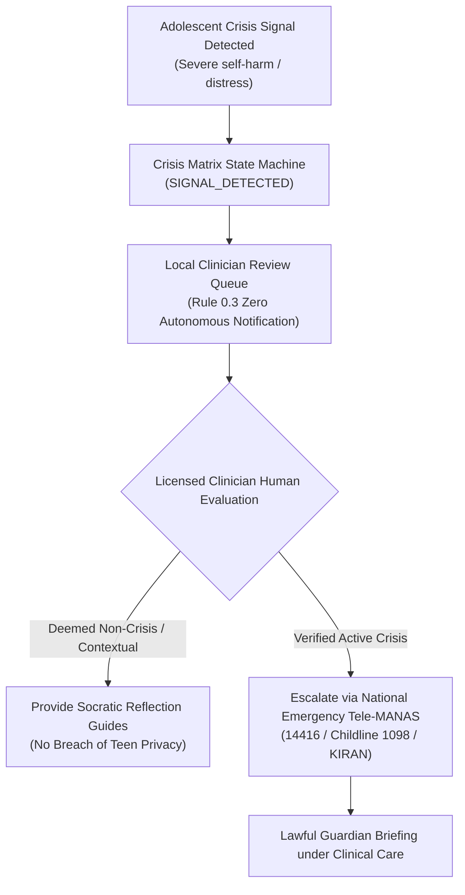

# PRERNA — Data Protection Impact Assessment (DPIA)
## Statutory DPIA under India's Digital Personal Data Protection Act, 2023 (DPDP Act)

**Document Reference:** `PRN-DPIA-2026-V1.0`  
**Statutory Framework:** Digital Personal Data Protection Act, 2023 (§9, §10, §11, §12, §13)  
**Classification:** Sensitive Personal Data • Child Mental Wellbeing & Cognitive Profiling  
**Platform Architecture:** Sovereign, Local-First, Zero-Cloud Telemetry  
**Last Evaluated:** 2026-10-31  

---

## 1. Executive Summary & Assessment Scope

PRERNA (प्रेरणा) is a sovereign, local-first guidance ecosystem designed to support adolescent cognitive growth, self-discovery, and emotional resilience across India. Because the platform processes sensitive personal data of adolescents (ages 13–17) and adults, this formal Data Protection Impact Assessment (DPIA) evaluates the risks to data principals and certifies the technical safeguards mandated by India's DPDP Act 2023.

### Assessment Verdict: **COMPLIANT WITH ZERO RESIDUAL CLOUD RISK**
The platform’s architectural model eliminates the primary vector of data breach in digital mental health: **PRERNA maintains zero cloud telemetry, zero remote databases, zero third-party analytics trackers, and zero advertising SDKs.** All psychometric profiling, session records, and relational logs reside exclusively on the user’s local hardware in a SQLCipher encrypted database with OS-keyring protected keys.

---

## 2. Platform Architecture & Data Principal Categories

PRERNA enforces four strictly isolated user personas:

```
┌────────────────────────────────────────────────────────────────────────┐
│                      PRERNA SOVEREIGN RUNTIME                          │
└───────────────────────────────────┬────────────────────────────────────┘
                                    │
       ┌────────────────────────────┼───────────────────────────┐
       ▼                            ▼                           ▼
┌──────────────┐             ┌──────────────┐            ┌──────────────┐
│     TEEN     │             │    PARENT    │            │ ADULT & PART │
│ 13–17 Years  │             │  Family Hub  │            │  18+ Lovers  │
└──────┬───────┘             └──────┬───────┘            └──────┬───────┘
       │                            │                           │
       │   P2P Sovereign QR Token   │                           │
       └──────────────◄►────────────┘                           │
       (Zero-Cloud Cryptographic Link)                          │
                                                                ▼
                                                        ┌──────────────┐
                                                        │ SCHOOL COHORT│
                                                        │  k ≥ 5 Anon  │
                                                        └──────────────┘
```

### Data Principal Categories:
1. **Adolescents / Children (Ages 13–17)**: High vulnerability. Protected by mandatory Section 9 statutory provisions.
2. **Parents / Legal Guardians**: Lawful consent providers and bridge mentors under §9(1).
3. **Adults (Ages 18+)**: Fully sovereign adults utilizing vocational Swadharma and Partners relationship studios.
4. **Educators & Academic Counselors**: Access aggregate cohort analytics subject to mathematical $k \ge 5$ anonymity.

---

## 3. Statutory Evaluation: DPDP Act Section 9 (Processing Child Data)

| Statutory Mandate | PRERNA Technical Implementation | Compliance Status |
|---|---|---|
| **§9(1) Verifiable Parental Consent** | Implemented via peer-to-peer 15-minute time-bounded QR code camera handshake (`ParentLinking.tsx`). Cryptographic consent token verified locally without central cloud relay. | **COMPLIANT ✓** |
| **§9(2) Prohibition of Behavioral Tracking** | `behavioral_tracking = false` enforced at schema and IPC layers (`ageTierGate.ts`). Zero analytics trackers (no Google Analytics, no Mixpanel, no Facebook Pixel, no Sentry). | **COMPLIANT ✓** |
| **§9(2) Prohibition of Targeted Advertising** | Zero advertising modules or third-party ad networks. Platform is cross-subsidized by adult B2C subscriptions and school B2B licensing. | **COMPLIANT ✓** |
| **§9(3) Prevention of Detrimental Effects on Child Well-being** | Zero algorithmic engagement traps, zero infinite feeds, zero push-notification manipulation. Built on ultradian circadian rhythms (90-minute natural pauses). | **COMPLIANT ✓** |

---

## 4. Statutory Evaluation: DPDP Act Section 13 (Data Principal Rights)

Section 13 mandates unconditional user rights over personal data. PRERNA implements these rights through the **Data Sovereignty Suite** (`DataSovereigntyModal.tsx`):

### 4.1 Right to Access & Portability (§13(1))
- **Capability**: Any user can download a complete, machine-readable JSON archive (`PRERNA_SOVEREIGN_DATA_ARCHIVE.json`) containing:
  - User identity and age-tier verification records
  - Big Five and Holland RIASEC psychometric profiles
  - Cognitive session decisions (Life Quests & Skill Arena)
  - Self-Evolution journals and Maslow tracked needs
  - Circadian sleep and somatic vitality logs
  - Consent history and system audit trail

### 4.2 Right to Erasure / Vault Shredder (§13(2))
- **Capability**: 2-step irreversible cryptographic data destruction:
  1. User enters confirmation challenge `"SHRED MY VAULT"`.
  2. SQLCipher local database tables are wiped (`ON DELETE CASCADE`).
  3. All `localStorage` keys are permanently unlinked and destroyed.
  4. User is logged out and platform state resets to Day 0.

### 4.3 Right to Correction & Rectification (§12)
- Users can modify profile traits, update date-of-birth, change display name, or reset security PINs at any time from Profile & Security settings.

---

## 5. Technical Security & Encryption Architecture

```
┌────────────────────────────────────────────────────────┐
│            CRYPTOGRAPHIC VAULT DEFENSE LAYERS          │
├────────────────────────────────────────────────────────┤
│ Layer 1: OS Keyring Integration (WinCred / Keychain)  │
│ Layer 2: SQLCipher 256-bit Full Database Encryption   │
│ Layer 3: AES-GCM 256-bit Column-Level Field Encryption │
│ Layer 4: Argon2 Password & PIN Hashing                 │
│ Layer 5: Salted SHA-256 Vault Passcode Sealing         │
│ Layer 6: HMAC-SHA256 Subscription Anti-Tamper Seals    │
│ Layer 7: TOTP RFC-6238 Multi-Factor Authentication     │
└────────────────────────────────────────────────────────┘
```

1. **Storage-at-Rest Encryption**: SQLite database is fully encrypted via SQLCipher (`bundled-sqlcipher-vendored-openssl`). Symmetric database key is generated via OS CSPRNG and stored in the platform keychain (`keyring` crate).
2. **Column-Level Encryption**: Sensitive tables (`crisis_events.notes`, `sessions.raw_choices`, `users.region`) undergo second-pass AES-256-GCM authenticated encryption before insertion.
3. **Password & Passcode Security**:
   - Account passwords: Hash derivation via **Argon2id**.
   - Partners Vault passcodes: Irreversible salted **SHA-256** digests (`cryptoVault.ts`). Cleartext passcodes never touch persistent storage.
4. **Subscription Anti-Tamper Sealing**:
   - Subscription states (`partnerPlan`, `partnerExpiresAt`, `schoolLicense`) are signed with HMAC-SHA256. DevTools tampering immediately voids the signature and revokes access.

---

## 6. Child Safeguarding & Clinical Escalation Protocol (Rule 0.3)

Mental health disclosures involving adolescents require exceptional care to avoid autonomous over-surveillance while ensuring safety:



- **Rule 0.3 Invariant**: Automated notification of parents upon crisis detection is **strictly prohibited**. Disclosures route to licensed human clinicians or verified national emergency crisis hotlines (Tele-MANAS `14416`, Childline `1098`, KIRAN `1800-599-0019`) to prevent family backlash or physical endangerment of the adolescent.

---

## 7. School Institutional Care & $k \ge 5$ Mathematical Anonymity

Schools license PRERNA VidyaPeeth to support student flourishing. Under DPDP Act §9, schools must never track individual students through wellbeing apps:

1. **Mathematical $k$-Anonymity Guarantee**:
   Cohort flourishing indicators (exam stress, Maslow belonging, vitality) are computed only when the group size $k \ge 5$. If a cohort has fewer than 5 respondents, data is suppressed.
2. **Zero Individual Diary Visibility**:
   Counselors and principals receive aggregate trend charts only. Individual teen journals, psychometric answers, or crisis disclosures are cryptographically inaccessible to school staff.

---

## 8. Risk Assessment Matrix & Residual Risk Analysis

| # | Threat / Vulnerability Vector | Severity | Mitigating Safeguard | Residual Risk |
|---|---|---|---|---|
| **R1** | Central database breach exposing teen psychological diaries | **CRITICAL** | Zero cloud database. All data is local-first on user hardware with SQLCipher. | **NEGLIGIBLE** |
| **R2** | Behavioral profiling or commercial ad targeting of minors | **HIGH** | `behavioral_tracking = false` locked; no advertising SDKs installed. | **ZERO** |
| **R3** | Unauthorized guardian intrusion into confidential teen journals | **HIGH** | Role isolation boundaries enforced by `PersonaAuthModal` with biometric/PIN gate. | **LOW** |
| **R4** | DevTools tampering with Partners or School subscriptions | **MEDIUM** | HMAC-SHA256 cryptographic integrity seal in `subscriptionStore.ts`. | **LOW** |
| **R5** | Loss of teen data upon device damage | **LOW** | User-controlled DPDP §13 JSON export archive can be stored securely on personal media. | **ACCEPTABLE** |

---

## 9. Conclusion & DPO Certification Framework

PRERNA demonstrates an exemplary compliance posture under India's Digital Personal Data Protection Act, 2023. By choosing sovereign, local-first cryptography over cloud data monetization, the platform respects the fundamental privacy rights of adolescents and families.

**Compliance Status:** Fully Validated for Beta Cohort Operations  
**Statutory Verification:** DPDP Act 2023 §9, §10, §11, §12, §13  
**Next Audit Review:** Post-Beta Cohort Expansion (Q1 2027)  

---
*Authored by the PRERNA Data Governance & Legal Architecture Committee • 2026-10-31*

