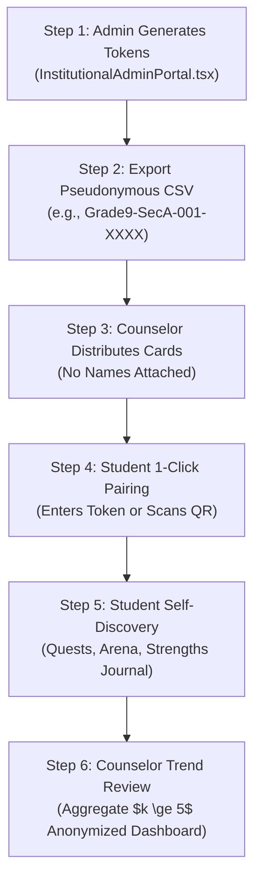

# PRERNA • VidyaPeeth School Counselor & Educator Pilot Handbook
### Institutional Guide for Adolescent Psychometric Discovery, Psychological Safety, & Holistic Development

---

## 1. Educational Vision & NEP 2020 Alignment

PRERNA (प्रेरणा) is engineered to operationalize the mandate of the **National Education Policy (NEP 2020)** for holistic, non-stigmatizing student development:
- **Zero Diagnostic Labeling**: PRERNA does not administer clinical psychopathology tests (such as BDI or PHQ-9) to adolescents. Instead, it measures validated growth traits: the Big Five (IPIP), Holland RIASEC career vectors, somatic circadian vitality, and psychological strengths.
- **Sant Kabir Creed**: *"Self Realisation is God's Realisation"* (आत्म-साक्षात्कार ही ईश्वर-साक्षात्कार है). Development begins with self-awareness, not external performance pressure.
- **DPDP Act 2023 Statutory Protection**: PRERNA collects zero student phone numbers, zero emails, and zero real names. All student profiles remain on-device or behind pseudonymous institutional tokens.

---

## 2. Institutional Architecture: The VidyaPeeth B2B Model

Under the **VidyaPeeth B2B Institutional Tier (₹49,999/yr + 18% GST)**:
- **Campus Capacity**: 1,500 active student seats per license.
- **Tax Invoice Specification (Sample Pilot)**: Sample tax invoice issued under SAC Code 998431 (Educational Support Services; pilot demonstration pending formal registration).
- **Zero-Cloud Student Data**: Student journal entries and psychometric assessments are stored strictly on student devices or local SQLite databases.
- **Differential Privacy & Differencing Attack Defense**: The school administration portal injects calibrated Laplace noise ($\epsilon = 1.0$) into average wellbeing metrics, enforces small-cell suppression ($\tau = 3$), and actively blocks differencing queries ($|Q_{new} \Delta Q_{past}| < 5$) to mathematically prevent student re-identification.

---

## 3. Step-by-Step Pilot Rollout Workflow

### Phase 1: Batch Token Generation
1. The School Administrator or Head Counselor logs into the **VidyaPeeth Institutional Portal**.
2. Select Grade (e.g. *Grade 9*), Section (e.g. *Section A*), and Batch Size (e.g. *40 students*).
3. Click **Generate Batch Tokens**. PRERNA cryptographically issues tokens following the scheme:
   `PRERNA-Grade9-SecA-001-A7F2`, `PRERNA-Grade9-SecA-002-B8E1`, etc.
4. Click **Export CSV** to save the classroom roster.

### Phase 2: Classroom Distribution
- Counselors print or hand out tokens to students during life-skills or homeroom periods.
- Students open PRERNA on web (`https://harshkumarg007.github.io/PRERNA/`) or school tablets.
- Students enter their token. No registration forms, no email signups, and no phone OTPs required.

### Phase 3: Engaging with Sanctuary Modules
- **Self-Discovery Journey**: Interactive 15-minute adaptive IPIP Big Five & RIASEC assessment.
- **16 Personalities Typology**: Jungian/Myers-Briggs personality reflection with Indian cultural grounding (Sant Kabir Dohas).
- **Kaya Kalpa Circadian Sleep**: 90-minute sleep cycle calculator ensuring students wake up during light sleep.
- **Somatic Breathing (432 Hz)**: In-browser coherent breathing companion for pre-exam anxiety grounding.

---

## 4. Cohort Analytics & Early-Warning Indicators

The Counselor Dashboard surfaces macro systemic trends across grade levels while strictly safeguarding individual privacy:

| Indicator | Normal Threshold | Early-Warning Alert Trigger | Counselor Intervention Action |
|---|---|---|---|
| **Circadian Sleep Rhythm** | $\ge 7.5$ hours | $> 35\%$ cohort reporting $< 6$ hours | Conduct grade-wide sleep hygiene workshop; evaluate homework/exam pacing |
| **Exam Stress Pulse** | Balanced | Spike in neuroticism/distress words | Schedule collective somatic breathing sessions; open drop-in peer support |
| **Strengths Journaling** | Active | $> 40\%$ inactive for 14 days | Homeroom teachers introduce 5-min weekly classroom gratitude micro-rituals |

---

## 5. Crisis Escalation & Rule 0.3 Invariant

If an adolescent writes phrases expressing acute distress or self-harm in AI Chat or Strengths Journal:
1. **Rule 0.1 Invariant**: PRERNA instantly suppresses any marketing or non-essential features and displays verified 24/7 helplines:
   - **Tele-MANAS**: `14416` (National Mental Health Helpline, 24/7 Free)
   - **Childline India**: `1098` (Emergency Adolescent Safety)
   - **KIRAN**: `1800-599-0019` (Ministry of Social Justice, 24/7)
   - **Vandrevala Foundation**: `9999 666 555`
2. **On-Campus Protocol**: The student is warmly encouraged to visit the school counselor's office during office hours.
3. **Parental Bridge**: In accordance with the DPDP Act 2023 §9, guardian escalation requires verified consent and teenager notification (`teen_informed_at`) prior to communication.

---

## 6. Counselor Support & Institutional Inquiries

- **Official Email**: `counseling@prerna-sanctuary.in`
- **Institutional Technical Desk**: `support@prerna-sanctuary.in`
- **Head Architect**: Harsh Kumar Gupta

